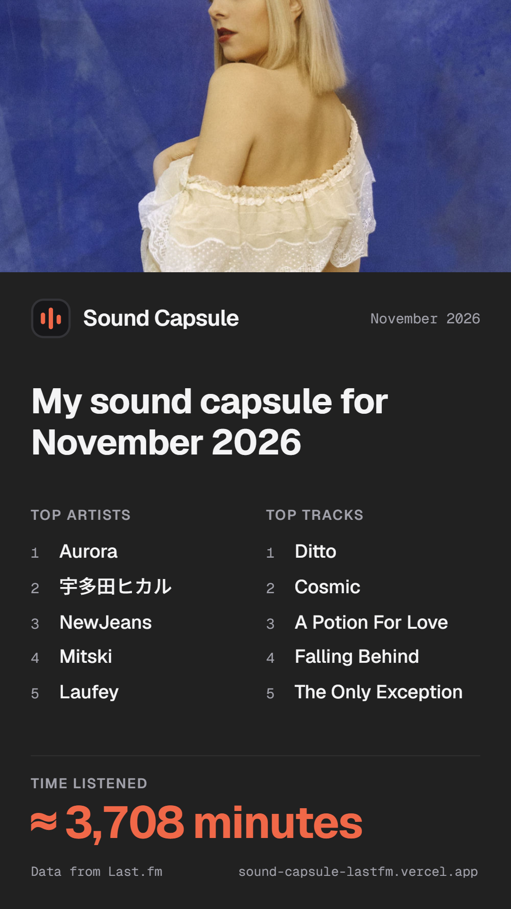

**English** · [Português](docs/readme/README.pt-BR.md) · [Español](docs/readme/README.es.md) · [Français](docs/readme/README.fr.md) · [Deutsch](docs/readme/README.de.md) · [Italiano](docs/readme/README.it.md) · [日本語](docs/readme/README.ja.md) · [한국어](docs/readme/README.ko.md) · [简体中文](docs/readme/README.zh-CN.md) · [Русский](docs/readme/README.ru.md) · [Polski](docs/readme/README.pl.md)

# Sound Capsule

Turn your Last.fm scrobbles into a **vertical 1080×1920 sound capsule** (story format) ready to download or share. Aggregation happens entirely in the browser, with no login and no database.

**Deploy:** <https://sound-capsule-lastfm.vercel.app>



> Sample card with demo data (Aurora photo from Deezer), hidden username, Ember theme and 3,708 minutes.

Example with Japanese, Korean and Chinese names rendered in the exported PNG: [card CJK](docs/screenshots/cjk-1080x1920.png).

## Features

- **Home screen** with a user input (accepts the username or the profile URL), period (last week, current month, or custom range), a 9:16 preview, and download/share actions.
- **Custom period with a maximum length of 3 calendar months** — no fixed 90-day window, and the chosen dates are not restricted (from the Last.fm sign-up date to today).
- **9:16 card** (432×768 CSS, exported as a 1080×1920 PNG) with the top 30% as the artist photo and a solid `#212121` body.
- **Five fixed color themes** (Ember, Tide, Moss, Plum, Sand) that change only the card's accent — no free color picker.
- **Artist photo** in three layers: automatic match on Deezer → optional local upload (never sent to the server) → canvas fallback with initials.
- **Two numbered columns** (Top artists and Top tracks, 1–5) with ellipsis truncation and CJK support (Japanese, Korean and Chinese).
- **Estimated listening time** highlighted in solid theme color, a tooltip explaining the calculation, and formatting via `Intl`.
- **Self-contained embed**: the "Copy embed code" button generates an HTML `<a></a>` block with the PNG in base64 — no upload, no storage, and no dependency on a hosted image URL (~0.5–0.8 MB). Works where raw HTML is allowed.
- **Link preview**: when you paste the site URL into WhatsApp, Discord, Twitter/X, Telegram, etc., a localized title and description and a branded 1200×630 Open Graph image appear.
- **Real pagination progress** ("Page 12 of 40"), a skeleton in the preview, and cancellation with `AbortController`.
- **i18n** in `pt`, `en`, `es`, `fr`, `de`, `it`, `ja`, `ko`, `zh`, `ru` and `pl`, with `Accept-Language` detection, prefixed routes, texts/dates/numbers formatted with `Intl`, and a custom, accessible language dropdown.
- **Card credits** ("Data from Last.fm", profile link and site URL), with an option to hide the username from the card.
- **`<canvas>` background** with subtle wave lines that react to the mouse, pause when the tab is hidden, and switch off with `prefers-reduced-motion`.
- **Accessible**: keyboard navigation, labels, `role="progressbar"`, alerts, AA contrast, and respect for reduced motion.
- **Observability**: Vercel Web Analytics and Speed Insights, cookieless, to track visits and Core Web Vitals.

## Persistence: language and theme only

| Data | Where it is stored | Detail |
| --- | --- | --- |
| Language | `NEXT_LOCALE` cookie | only `pt`, `en`, … |
| Card color | `localStorage` (`sound-capsule:theme`) | only the accent id |
| Username, dates, API result, uploaded photo | **memory** | gone on F5 |

Switching languages preserves the username and the card in memory (without new requests to Last.fm), but a reload clears that data. No scrobble, history, or photo data is persisted.

## Stack

| Layer | Choice |
| --- | --- |
| Framework | Next.js 15 (App Router) + TypeScript |
| Styling | Tailwind CSS 4 |
| i18n | `next-intl` 4 |
| Image export | `html-to-image` (client-side) |
| Tests | Vitest |
| Deployment | Vercel (serverless, static + route handlers) |

## How it works

```text
Browser
  ├─ validates the user/period (max. 3 calendar months)
  ├─ /api/lastfm  ──────────►  Last.fm API (key injected on the server)
  │     └─ user.getInfo, user.getRecentTracks, track.getInfo
  ├─ pages through ALL scrobble pages (concurrency 3 + 150 ms pacer)
  ├─ aggregates in memory: top artists, top tracks, listening time
  ├─ /api/artist-image ─────►  Deezer search (best normalized match)
  ├─ /api/image-proxy  ─────►  Deezer CDN (allowlist *.dzcdn.net)
  ├─ optional user photo ───►  local canvas (never leaves the browser)
  └─ renders the card in the DOM and exports a 1080×1920 PNG
```

The app does not fetch data on page load; only when the user clicks Generate. Public responses use CDN caching with `Vercel-CDN-Cache-Control`; a cache hit does not invoke the function.

## Running locally

### Requirements

- Node.js **20.9+**
- pnpm **9+** (the repository was developed with pnpm 11)

### 1. Get a Last.fm API key

1. Go to <https://www.last.fm/api/account/create>.
2. Fill in the app name (e.g. *Sound Capsule*), the URL `https://sound-capsule-lastfm.vercel.app`, and the description.
3. Copy the generated **API key** (the *shared secret* is not needed, since there is no user authentication).

### 2. Configure the environment

```bash
cp .env.example .env.local
# edit .env.local and fill in:
LASTFM_API_KEY=your_key_here
```

The variable is **server-only**. Never use the `NEXT_PUBLIC_` prefix, and it does not go into the client bundle.

### 3. Install and run

```bash
pnpm install
pnpm dev
```

Open <http://localhost:3000> — the middleware redirects to the locale detected from `Accept-Language` (or from the `NEXT_LOCALE` cookie).

### Scripts

| Command | Description |
| --- | --- |
| `pnpm dev` | development server |
| `pnpm build` | production build |
| `pnpm start` | serves the production build |
| `pnpm test` | unit tests (Vitest) |
| `pnpm test:watch` | tests in watch mode |
| `pnpm typecheck` | type check with `tsc --noEmit` |

## Deploying to Vercel

The current deployment is at <https://sound-capsule-lastfm.vercel.app>.

1. Push the project to a repository on GitHub/GitLab/Bitbucket.
2. In Vercel, click **Add New → Project** and import the repository.
3. The **Next.js** preset is detected automatically. Confirm:
   - Install Command: `pnpm install`
   - Build Command: `pnpm build`
   - Output: Next.js default
4. Under **Settings → Environment Variables**, add `LASTFM_API_KEY` in Production (and, if you want to test previews, in Preview/Development as well).
5. Deploy. There is no database, migrations, cron jobs, or storage to configure.
6. Optional: configure a custom domain under **Settings → Domains**.

The project was designed for the **Hobby** plan (personal/non-commercial): each typical capsule makes ~60–176 function invocations, and CDN caching avoids repeating stable calls. The photo upload is 100% local, so it consumes no function, bandwidth, or the Vercel 4.5 MB body limit.

Production notes:

- The route handlers use `AbortSignal.timeout(10s)` for the upstream; each call is short and independent.
- `track.getInfo` and images stay in the CDN for 24 h; user data stays for 1–5 min. Errors are never cached.
- The image proxy responds in streaming mode so it does not hit the 4.5 MB non-streamed response limit.
- The CJK fonts are self-hosted by `next/font` during the build; the environment needs access to Google Fonts.

## Structure

```text
app/
  [locale]/
    layout.tsx            # root layout: fonts, i18n provider, metadata/SEO
    page.tsx              # home screen (server) + CapsuleStudio (client)
    [...rest]/page.tsx    # unknown routes → notFound()
  api/
    lastfm/route.ts       # proxy with an allowlist of methods and params
    artist-image/route.ts # Deezer search + normalized matching
    image-proxy/route.ts  # image proxy (allowlist + streaming)
  robots.ts               # robots.txt (blocks /api/, points to the sitemap)
  sitemap.ts              # sitemap of the 11 routes with alternates
  globals.css             # design tokens (Tailwind 4)
  icon.svg                # brand/favicon
components/
  CapsuleStudio.tsx       # form, theme, upload, progress, export/share/embed
  CapsuleCard.tsx         # 432×768 card with credits and theme
  CardHero.tsx            # artist photo/upload or canvas fallback
  BackgroundCanvas.tsx    # background waves (mouse, reduced motion, hidden)
  SiteHeader.tsx / SiteFooter.tsx / BrandMark.tsx
  LocaleSwitcher.tsx      # custom, accessible language dropdown
i18n/                     # next-intl routing/request/navigation
lib/
  lastfmClient.ts         # pagination, concurrency, pacer, retry/backoff, abort
  aggregate.ts            # aggregation and minutes estimate (tested)
  periods.ts              # intervals, 3-month limit, Intl
  artistMatch.ts          # normalized Deezer matching
  artistImage.ts          # hero photo resolution/preloading
  localPhoto.ts           # local validation/resize of the uploaded photo
  cardThemes.ts           # fixed accents and persisting only the id
  studioSession.ts        # in-memory state for switching languages
  site.ts / httpCache.ts  # URL/User-Agent and cache headers
  exportCard.ts           # font embed + html-to-image → 1080×1920 PNG
  initials.ts / locales.ts
public/
  og/<locale>.png          # Open Graph/Twitter preview 1200×630
  llms.txt                # project summary for agents/LLMs
messages/                 # pt, en, es, fr, de, it, ja, ko, zh, ru, pl
tests/                    # Vitest
docs/screenshots/         # reference screenshots
```

## Link preview, SEO and discovery

- `metadataBase` + Open Graph/Twitter Card on all 11 routes, with localized title and description.
- `public/og/<locale>.png` image (1200×630) used in `og:image` and `twitter:image`; it is the preview shown when the link is pasted into WhatsApp, Discord, Telegram, Twitter/X, etc.
- `/robots.txt` generated by `app/robots.ts`, allowing the site, blocking `/api/`, and pointing to the sitemap.
- `/sitemap.xml` generated by `app/sitemap.ts`, with the 11 routes and `hreflang` alternates.
- `/llms.txt` with a factual summary of the product, data sources, and privacy policy for AI agents.

## Technical decisions

### Why `user.getRecentTracks` instead of `user.getTopTracks`?

`getTopTracks`/`getTopArtists` only accept fixed windows (`7day`, `1month`…), and Last.fm's "month" is not the current calendar month. The app paginates `user.getRecentTracks` with `from`/`to` (unix) and aggregates locally, guaranteeing that **"current month"** is exactly from day 1 until now in the visitor's time zone.

- `limit=200` per page; the first page discovers `totalPages`.
- The remaining pages run in parallel with **concurrency 3**, with a **150 ms pacer between calls** to stay within Last.fm's usage guidance.
- Retry with **exponential backoff** for error 29 (rate limit), 5xx, and network failures.
- The "now playing" track (`@attr.nowplaying`) is ignored.
- The **Cancel** button aborts all in-flight requests (`AbortController`).

### Listening time

Last.fm does not expose listening time. The estimate:

1. Fetches the real duration (`track.getInfo` → `duration` in ms) for the **50 most-played tracks** (concurrency 3).
2. Tracks without a duration, with a duration of 0, or outside the top 50 use **3.5 min (210 s)**.
3. `minutes = round(Σ duration × scrobbles / 60,000)`.

The UI shows the value as approximate (`≈ 66 minutes`) and the tooltip explains the calculation. The fallback and the top-50 limit are configurable in `lib/periods.ts`.

### Artist photo

Last.fm no longer returns real photos (placeholder). The app calls Deezer, picks the result with the best normalized similarity, and prioritizes the **most popular exact match** among duplicate names — without that, an obscure "Twice" could show up instead of TWICE. The user can also upload a local photo (JPEG/PNG/WebP, up to 10 MB): it is resized on the canvas and used only in the browser's memory. If nothing is found, the card uses the procedural canvas fallback.

### Themes

Five fixed accents in `lib/cardThemes.ts`; only the card's accent color changes (brand and listening time). The chosen id is the only theme data saved, in `localStorage`. The site itself stays neutral.

### State across languages

`CapsuleStudio` keeps the non-localized data in an in-memory store (`lib/studioSession.ts`). When switching languages, the component remounts, hydrates from the store, and only recomputes the texts with the new locale — **zero requests to Last.fm**. The language itself is persisted in the `NEXT_LOCALE` cookie.

### Export 1080×1920

`html-to-image` renders the card (432×768) with `pixelRatio: 2.5`. Before exporting:

- `document.fonts.ready` + two layout frames;
- every `` in the card is decoded;
- a tailor-made font embed includes **only the subsets whose `unicode-range` intersects the card's characters**, avoiding downloading megabytes of unnecessary CJK slices.

The final PNG is exactly **1080×1920** (verified in a browser, including with a user-uploaded photo).

### Design

Neutral palette, a single solid accent color per card, no neon/gradient/glassmorphism:

| Token | Value |
| --- | --- |
| Background | `#0f0f10` |
| Form surface | `#171719` |
| Inputs | `#111113` |
| Card body | `#212121` |
| Accents | Ember `#F06848`, Tide `#5B9DFF`, Moss `#7ED08A`, Plum `#C084FC`, Sand `#E7C27A` |
| Text | `#f4f4f5` / muted `#a1a1aa` |

Typography: Geist (sans) + Geist Mono (numbers/details) + Noto Sans JP/KR/SC for CJK.

## Privacy, security and TOS

- `LASTFM_API_KEY` exists only on the server; the client never receives it.
- `/api/lastfm` accepts only `user.getInfo`, `user.getRecentTracks` and `track.getInfo`; it rejects `api_key`/`format` sent by the client, validates integers (ranges and limits), the username, and control characters.
- `/api/image-proxy` accepts only `https` URLs on `*.dzcdn.net`, revalidates the host after redirects, requires `Content-Type: image/*`, and responds in streaming mode.
- The app sends an identifiable User-Agent to Last.fm/Deezer.
- Attribution per the [Last.fm TOS](https://www.last.fm/api/tos): a "powered by Last.fm" link in the footer and "Data from Last.fm", profile, and site URL credits on the exported card.
- **Only persisted data**: language (cookie) and card accent (`localStorage`). There is no database, scrobble storage, login, or session cookies.
- Nothing from the user's history is recorded in the app logs. The project is personal and non-commercial.

### Observability

- Vercel Web Analytics (`@vercel/analytics`) and Speed Insights (`@vercel/speed-insights`) are installed in the locale layout.
- Both are cookieless: they do not collect usernames, card data, or scrobble data.
- On Hobby, Web Analytics includes 50,000 events/month and Speed Insights includes 10,000 events over the last 30 days; both are free within those limits, and collection pauses instead of billing for overage.

## i18n

- Locales: `pt` (default, pt-BR content), `en`, `es`, `fr`, `de`, `it`, `ja`, `ko`, `zh` (Simplified Chinese), `ru` and `pl`.
- Detection via `Accept-Language` in the middleware (the `NEXT_LOCALE` cookie takes priority); manual switching in the header preserves the route and the card in memory. The selector is a custom dropdown, not the native `<select>`.
- Dates and numbers use `Intl` with the correct regional locale (`pt-BR`, `en-US`, `es-ES`, `fr-FR`, `de-DE`, `it-IT`, `ja-JP`, `ko-KR`, `zh-CN`, `ru-RU`, `pl-PL`).
- The card text is translated along with the interface; the exported image already uses the active language.
- Fonts: Geist loads latin/latin-ext/Cyrillic; Noto Sans JP/KR/SC covers the CJK characters in the card.

## Tests

```bash
pnpm test        # 108 unit tests
pnpm typecheck
pnpm build
```

Current coverage:

- normalization of profile URLs pasted into the user field;
- scrobble aggregation, tie-breakers, CJK, and listening-time calculation;
- period intervals, the **3-calendar-month** limit, February/31-day months, registration, future, and `Intl`;
- Last.fm client with mocked `fetch`: pagination, now playing, retry 29/network, abort, top-50 durations, errors 6/17, sign-up date (`unixtime`);
- Deezer artist matching (including popularity tie-breaking among duplicate names);
- API routes: allowlist, server key, User-Agent, cache headers, image proxy streaming;
- themes and session store;
- local upload validation (type/size).

In addition, the flow was verified in Chromium with simulated Last.fm/Deezer: theme, upload, credits, hidden username, self-contained embed (clipboard), language switching without new requests, custom dropdown (mouse, keyboard and click outside), `ko`/`ru`/`zh`/`pl` routes, automatic scroll to the preview on mobile, only cookie/localStorage allowed, F5, 3-month validation, and **1080×1920** export. The real flow was also run against the Last.fm/Deezer API with an active profile.

## Known limitations

- **Maximum period of 3 calendar months**: designed to fit within Last.fm's reasonable use and the Hobby plan. Yearly recaps would require a different architecture/limit.
- **Listening time is an estimate**: it depends on `track.getInfo` durations and the 210 s fallback; live tracks/remixes may diverge.
- **Photos come from Deezer**: name matching can fail for artists with the same name or find nothing (it uses the canvas fallback). Names in another script (e.g. 南翔子, indexed as "Shoko Minami") may have no match. The local upload covers those cases.
- **Uploads are not persisted**: the photo exists only in memory and is gone on F5, like the result and the username.
- **Private profiles** ("hide recent listening") return error 17; the app explains how to enable it.
- **Client-side export** depends on the browser (tested in Chromium). On old devices/Safari with little memory the PNG may fail; there is an error message.
- **Web Share API** is not available in every browser; in those cases the app downloads the PNG.
- The card renders photos and fonts only once loaded; the preview waits for loading before enabling the PNG.

## Troubleshooting

| Symptom | Likely cause / solution |
| --- | --- |
| "The server is missing the API key" | `LASTFM_API_KEY` missing from `.env.local` (or on Vercel); restart the server. |
| "User not found" | invalid or non-existent username; check it at `last.fm/user/<name>`. |
| "Private scrobbles" | enable "Show recent listening" in Last.fm's privacy settings. |
| "No scrobbles in the period" | the chosen period has no public history. |
| "Rate limit" | wait and try again; the app already applies a pacer and backoff. |
| Preview without a photo | Deezer did not find the artist; upload a photo or use the geometric fallback. |
| "Use JPEG, PNG or WebP" / "maximum 10 MB" | local photo format/size outside the allowed range. |
| CJK fonts do not appear | check that the build could download Noto Sans JP/KR/SC from Google Fonts. |
| Build fails at `prerender /404` | symptom of corrupted `node_modules`; remove `node_modules` and run `pnpm install` again. |

## Disclaimer

Sound Capsule is an independent project, not affiliated with Last.fm or any streaming service. Music data is public and provided by the Last.fm API; artist photos come from Deezer or the user. Use of the Vercel Hobby plan is personal and non-commercial.

## Credits

Created by [Ranieeery](https://github.com/Ranieeery).

