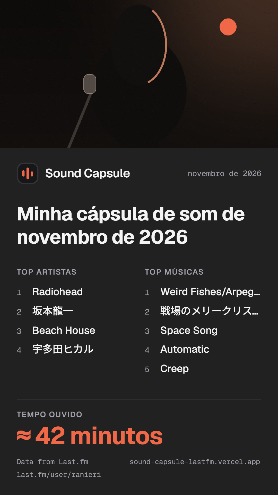

**English** · [Português](README.pt-BR.md) · [Español](README.es.md) · [Français](README.fr.md) · [Deutsch](README.de.md) · [Italiano](README.it.md) · [日本語](README.ja.md) · [한국어](README.ko.md) · [简体中文](README.zh-CN.md) · [Русский](README.ru.md) · [Polski](README.pl.md)

# Sound Capsule

Превратите ваши скробблы из Last.fm в **вертикальную звуковую капсулу 1080×1920** (формат сторис), готовую к скачиванию или публикации. Вся агрегация выполняется в браузере — без входа и без базы данных.

**Деплой:** <https://sound-capsule-lastfm.vercel.app>



> На скриншотах используются смоделированные данные, чтобы показать состояния интерфейса. Фоновое изображение карточки — синтетический тестовый портрет; в рабочей версии оно берётся из Deezer или из фотографии, загруженной пользователем.

Пример с японскими, корейскими и китайскими именами в экспортированном PNG: [карточка CJK](docs/screenshots/cjk-1080x1920.png).

## Возможности

- **Главный экран** с полем ввода пользователя (принимает имя пользователя или URL профиля), периодом (последняя неделя, текущий месяц или произвольный диапазон), превью 9:16 и действиями скачивания/публикации.
- **Произвольный период длиной не более 3 календарных месяцев** — без фиксированного окна в 90 дней, выбранные даты не ограничиваются (от даты регистрации в Last.fm до сегодняшнего дня).
- **Карточка 9:16** (432×768 в CSS, экспорт в PNG 1080×1920): верхние 30% — фото артиста, тело — сплошной цвет `#212121`.
- **Пять фиксированных цветовых тем** (Ember, Tide, Moss, Plum, Sand), которые меняют только акцент карточки — без свободного выбора цвета.
- **Фото артиста** в три слоя: автоматический подбор в Deezer → необязательная локальная загрузка (никогда не отправляется на сервер) → запасной вариант на canvas с инициалами.
- **Два нумерованных столбца** (топ артистов и топ треков, 1–5) с обрезкой многоточием и поддержкой CJK (японский, корейский и китайский).
- **Оценка времени прослушивания**, выделенная сплошным цветом темы, подсказка с объяснением расчёта и форматирование через `Intl`.
- **Самодостаточный embed**: кнопка «Скопировать embed-код» генерирует HTML-блок `<a></a>` с PNG в base64 — без загрузки, без хранилища и без зависимости от размещённого URL изображения (~0,5–0,8 МБ). Работает там, где разрешён сырой HTML.
- **Превью ссылки**: при вставке URL сайта в WhatsApp, Discord, Twitter/X, Telegram и т. п. отображаются локализованные заголовок и описание, а также фирменное изображение Open Graph 1200×630.
- **Реальный прогресс постраничной загрузки** («Стр. 12 из 40»), скелетон превью и отмена через `AbortController`.
- **i18n** на `pt`, `en`, `es`, `fr`, `de`, `it`, `ja`, `ko`, `zh`, `ru` и `pl`, с определением по `Accept-Language`, маршрутами с префиксом, форматированием текстов/дат/чисел через `Intl` и настраиваемым доступным выпадающим списком языков.
- **Подписи на карточке** («Data from Last.fm», ссылка на профиль и URL сайта), с возможностью скрыть имя пользователя на карточке.
- **Фон на `<canvas>`** с деликатными волновыми линиями, которые реагируют на мышь, приостанавливаются при скрытой вкладке и отключаются при `prefers-reduced-motion`.
- **Доступность**: навигация с клавиатуры, подписи, `role="progressbar"`, оповещения, контраст AA и уважение к уменьшению анимации.
- **Наблюдаемость**: Vercel Web Analytics и Speed Insights без cookie для отслеживания визитов и Core Web Vitals.

## Сохранение данных: только язык и тема

| Данные | Где хранятся | Детали |
| --- | --- | --- |
| Язык | cookie `NEXT_LOCALE` | только `pt`, `en`, … |
| Цвет карточки | `localStorage` (`sound-capsule:theme`) | только id акцента |
| Имя пользователя, даты, результат API, загруженное фото | **память** | исчезает при F5 |

Переключение языка сохраняет имя пользователя и карточку в памяти (без новых запросов к Last.fm), но перезагрузка страницы очищает эти данные. Никакие данные скробблов, истории или фото не сохраняются.

## Стек

| Слой | Выбор |
| --- | --- |
| Фреймворк | Next.js 15 (App Router) + TypeScript |
| Стилизация | Tailwind CSS 4 |
| i18n | `next-intl` 4 |
| Экспорт изображения | `html-to-image` (на стороне клиента) |
| Тесты | Vitest |
| Деплой | Vercel (serverless, статика + route handlers) |

## Как это работает

```text
Браузер
  ├─ проверяет пользователя и период (макс. 3 календарных месяца)
  ├─ /api/lastfm  ──────────►  Last.fm API (ключ внедряется на сервере)
  │     └─ user.getInfo, user.getRecentTracks, track.getInfo
  ├─ перебирает ВСЕ страницы скробблов (параллелизм 3 + пауза 150 мс)
  ├─ агрегирует в памяти: топ артистов, топ треков, время прослушивания
  ├─ /api/artist-image ─────►  поиск в Deezer (лучшее нормализованное совпадение)
  ├─ /api/image-proxy  ─────►  CDN Deezer (белый список *.dzcdn.net)
  ├─ необязательное фото пользователя ─►  локальный canvas (не покидает браузер)
  └─ рендерит карточку в DOM и экспортирует PNG 1080×1920
```

Приложение не загружает данные при открытии страницы, только по нажатию кнопки «Создать капсулу». Публичные ответы кешируются на CDN через `Vercel-CDN-Cache-Control`; попадание в кеш не вызывает функцию.

## Локальный запуск

### Требования

- Node.js **20.9+**
- pnpm **9+** (репозиторий разрабатывался на pnpm 11)

### 1. Получите ключ API Last.fm

1. Перейдите на <https://www.last.fm/api/account/create>.
2. Укажите название приложения (например, *Sound Capsule*), URL `https://sound-capsule-lastfm.vercel.app` и описание.
3. Скопируйте сгенерированный **ключ API** (*shared secret* не нужен, так как аутентификации пользователей нет).

### 2. Настройте окружение

```bash
cp .env.example .env.local
# отредактируйте .env.local и заполните:
LASTFM_API_KEY=your_key_here
```

Переменная доступна **только на сервере**. Никогда не используйте префикс `NEXT_PUBLIC_`, и она не попадает в клиентский бандл.

### 3. Установка и запуск

```bash
pnpm install
pnpm dev
```

Откройте <http://localhost:3000> — middleware перенаправит на локаль, определённую по `Accept-Language` (или по cookie `NEXT_LOCALE`).

### Скрипты

| Команда | Описание |
| --- | --- |
| `pnpm dev` | сервер разработки |
| `pnpm build` | продакшен-сборка |
| `pnpm start` | раздаёт продакшен-сборку |
| `pnpm test` | юнит-тесты (Vitest) |
| `pnpm test:watch` | тесты в режиме наблюдения |
| `pnpm typecheck` | проверка типов через `tsc --noEmit` |

## Развёртывание на Vercel

Текущее развёртывание доступно по адресу <https://sound-capsule-lastfm.vercel.app>.

1. Отправьте проект в репозиторий на GitHub/GitLab/Bitbucket.
2. В Vercel нажмите **Add New → Project** и импортируйте репозиторий.
3. Пресет **Next.js** определяется автоматически. Проверьте:
   - Install Command: `pnpm install`
   - Build Command: `pnpm build`
   - Output: по умолчанию для Next.js
4. В разделе **Settings → Environment Variables** добавьте `LASTFM_API_KEY` в Production (а если хотите тестировать превью — также в Preview/Development).
5. Выполните деплой. База данных, миграции, cron-задачи и хранилище не требуются.
6. Необязательно: настройте собственный домен в **Settings → Domains**.

Проект рассчитан на план **Hobby** (личный/некоммерческий): каждая типичная капсула делает ~60–176 вызовов функций, а кеширование на CDN позволяет не повторять стабильные вызовы. Загрузка фото выполняется на 100% локально, поэтому не расходует ни функцию, ни трафик, ни лимит тела запроса Vercel в 4.5 MB.

Замечания для продакшена:

- Обработчики маршрутов используют `AbortSignal.timeout(10s)` для запросов к upstream; каждый вызов короткий и независимый.
- `track.getInfo` и изображения хранятся в CDN 24 часа; пользовательские данные — 1–5 минут. Ошибки никогда не кешируются.
- Прокси изображений отвечает в потоковом режиме, поэтому не упирается в лимит 4.5 MB для непоточных ответов.
- Шрифты CJK размещаются самостоятельно через `next/font` во время сборки; окружению нужен доступ к Google Fonts.

## Структура

```text
app/
  [locale]/
    layout.tsx            # корневой layout: шрифты, i18n-провайдер, метаданные/SEO
    page.tsx              # главный экран (сервер) + CapsuleStudio (клиент)
    [...rest]/page.tsx    # неизвестные маршруты → notFound()
  api/
    lastfm/route.ts       # прокси с белым списком методов и параметров
    artist-image/route.ts # поиск в Deezer + нормализованное сопоставление
    image-proxy/route.ts  # прокси изображений (белый список + потоковая отдача)
  robots.ts               # robots.txt (блокирует /api/, указывает на карту сайта)
  sitemap.ts              # карта сайта из 11 маршрутов с alternates
  globals.css             # дизайн-токены (Tailwind 4)
  icon.svg                # бренд/favicon
components/
  CapsuleStudio.tsx       # форма, тема, загрузка, прогресс, экспорт/публикация/embed
  CapsuleCard.tsx         # карточка 432×768 с подписями и темой
  CardHero.tsx            # фото артиста/загрузка или запасной canvas
  BackgroundCanvas.tsx    # фоновые волны (мышь, уменьшение анимации, скрытие)
  SiteHeader.tsx / SiteFooter.tsx / BrandMark.tsx
  LocaleSwitcher.tsx      # настраиваемый доступный список языков
i18n/                     # маршрутизация/запросы/навигация next-intl
lib/
  lastfmClient.ts         # пагинация, параллелизм, паузы, повтор/бэкофф, прерывание
  aggregate.ts            # агрегация и оценка в минутах (покрыто тестами)
  periods.ts              # интервалы, лимит 3 месяцев, Intl
  artistMatch.ts          # нормализованное сопоставление в Deezer
  artistImage.ts          # подбор/предзагрузка главного фото
  localPhoto.ts           # локальная проверка/масштабирование загруженного фото
  cardThemes.ts           # фиксированные акценты и сохранение только id
  studioSession.ts        # состояние в памяти для смены языка
  site.ts / httpCache.ts  # URL/User-Agent и заголовки кеша
  exportCard.ts           # встраивание шрифтов + html-to-image → PNG 1080×1920
  initials.ts / locales.ts
public/
  og.png                  # превью Open Graph/Twitter 1200×630
  llms.txt                # краткое описание проекта для агентов/LLM
messages/                 # pt, en, es, fr, de, it, ja, ko, zh, ru, pl
tests/                    # Vitest
docs/screenshots/         # эталонные скриншоты
```

## Превью ссылок, SEO и обнаруживаемость

- `metadataBase` + Open Graph/Twitter Card на всех 11 маршрутах, с локализованными заголовком и описанием.
- Изображение `public/og.png` (1200×630) используется в `og:image` и `twitter:image`; это превью, которое показывается при вставке ссылки в WhatsApp, Discord, Telegram, Twitter/X и т. п.
- `/robots.txt` генерируется `app/robots.ts`: разрешает сайт, блокирует `/api/` и указывает на карту сайта.
- `/sitemap.xml` генерируется `app/sitemap.ts` и содержит 11 маршрутов с альтернативами `hreflang`.
- `/llms.txt` с фактологическим описанием продукта, источников данных и политики конфиденциальности для ИИ-агентов.

## Технические решения

### Почему `user.getRecentTracks`, а не `user.getTopTracks`?

`getTopTracks`/`getTopArtists` принимают только фиксированные окна (`7day`, `1month`…), а «месяц» в Last.fm — это не текущий календарный месяц. Приложение постранично загружает `user.getRecentTracks` с `from`/`to` (unix) и агрегирует локально, гарантируя, что **«текущий месяц»** — это ровно с 1-го числа до текущего момента в часовом поясе посетителя.

- `limit=200` на страницу; первая страница определяет `totalPages`.
- Остальные страницы выполняются параллельно с **параллелизмом 3** и **паузой 150 мс между вызовами**, чтобы не выходить за рекомендации Last.fm по использованию.
- Повтор с **экспоненциальной задержкой** для ошибки 29 (лимит запросов), 5xx и сетевых сбоев.
- Трек «сейчас играет» (`@attr.nowplaying`) игнорируется.
- Кнопка **«Отмена»** прерывает все выполняющиеся запросы (`AbortController`).

### Время прослушивания

Last.fm не раскрывает время прослушивания. Оценка:

1. Запрашивает реальную длительность (`track.getInfo` → `duration` в мс) для **50 самых прослушиваемых треков** (параллелизм 3).
2. Треки без длительности, с длительностью 0 или вне топ-50 считаются по **3,5 мин (210 с)**.
3. `minutes = round(Σ duration × scrobbles / 60,000)`.

В интерфейсе значение показывается как приблизительное (`≈ 66 мин`), а подсказка объясняет расчёт. Запасное значение и лимит топ-50 настраиваются в `lib/periods.ts`.

### Фото артиста

Last.fm больше не возвращает реальные фото (заглушка). Приложение обращается к Deezer, выбирает результат с лучшим нормализованным сходством и отдаёт приоритет **самому популярному точному совпадению** среди дублирующихся имён — без этого вместо TWICE мог бы появиться малоизвестный «Twice». Пользователь также может загрузить локальное фото (JPEG/PNG/WebP, до 10 MB): оно уменьшается на canvas и используется только в памяти браузера. Если ничего не найдено, карточка использует процедурный запасной вариант на canvas.

### Темы

Пять фиксированных акцентов в `lib/cardThemes.ts`; меняется только акцентный цвет карточки (бренд и время прослушивания). Сохраняется только выбранный id темы — в `localStorage`. Сам сайт остаётся нейтральным.

### Состояние при смене языка

`CapsuleStudio` хранит нелокализованные данные в хранилище в памяти (`lib/studioSession.ts`). При смене языка компонент перемонтируется, гидрируется из хранилища и только пересчитывает тексты с новой локалью — **ноль запросов к Last.fm**. Сам язык сохраняется в cookie `NEXT_LOCALE`.

### Экспорт 1080×1920

`html-to-image` рендерит карточку (432×768) с `pixelRatio: 2.5`. Перед экспортом:

- `document.fonts.ready` + два кадра раскладки;
- каждое `` в карточке декодируется;
- специальное встраивание шрифтов включает **только те подмножества, чей `unicode-range` пересекается с символами карточки**, избегая загрузки мегабайтов ненужных CJK-срезов.

Итоговый PNG — ровно **1080×1920** (проверено в браузере, в том числе с загруженным пользователем фото).

### Дизайн

Нейтральная палитра, один сплошной акцентный цвет на карточку, без неона, градиентов и glassmorphism:

| Токен | Значение |
| --- | --- |
| Фон | `#0f0f10` |
| Поверхность формы | `#171719` |
| Поля ввода | `#111113` |
| Тело карточки | `#212121` |
| Акценты | Ember `#F06848`, Tide `#5B9DFF`, Moss `#7ED08A`, Plum `#C084FC`, Sand `#E7C27A` |
| Текст | `#f4f4f5` / приглушённый `#a1a1aa` |

Типографика: Geist (sans) + Geist Mono (цифры/детали) + Noto Sans JP/KR/SC для CJK.

## Приватность, безопасность и TOS

- `LASTFM_API_KEY` существует только на сервере; клиент её никогда не получает.
- `/api/lastfm` принимает только `user.getInfo`, `user.getRecentTracks` и `track.getInfo`; отклоняет присланные клиентом `api_key`/`format`, проверяет целые числа (диапазоны и лимиты), имя пользователя и управляющие символы.
- `/api/image-proxy` принимает только `https`-URL на `*.dzcdn.net`, повторно проверяет хост после редиректов, требует `Content-Type: image/*` и отвечает в потоковом режиме.
- Приложение отправляет идентифицируемый User-Agent в Last.fm/Deezer.
- Атрибуция согласно [Last.fm TOS](https://www.last.fm/api/tos): ссылка «powered by Last.fm» в футере и подписи «Data from Last.fm», профиль и URL сайта на экспортированной карточке.
- **Сохраняются только**: язык (cookie) и акцент карточки (`localStorage`). Нет базы данных, хранения скробблов, входа и сессионных cookie.
- Ничего из истории пользователя не записывается в логи приложения. Проект личный и некоммерческий.

### Наблюдаемость

- Vercel Web Analytics (`@vercel/analytics`) и Speed Insights (`@vercel/speed-insights`) установлены в layout локали.
- Оба работают без cookie: не собирают имена пользователей, данные карточек или скробблов.
- На Hobby Web Analytics включает 50,000 событий в месяц, а Speed Insights — 10,000 событий за последние 30 дней; в этих пределах всё бесплатно, а при превышении сбор приостанавливается вместо выставления счёта.

## i18n

- Локали: `pt` (по умолчанию, контент pt-BR), `en`, `es`, `fr`, `de`, `it`, `ja`, `ko`, `zh` (упрощённый китайский), `ru` и `pl`.
- Определение по `Accept-Language` в middleware (cookie `NEXT_LOCALE` имеет приоритет); ручное переключение в шапке сохраняет маршрут и карточку в памяти. Селектор — настраиваемый выпадающий список, а не нативный `<select>`.
- Даты и числа используют `Intl` с правильной региональной локалью (`pt-BR`, `en-US`, `es-ES`, `fr-FR`, `de-DE`, `it-IT`, `ja-JP`, `ko-KR`, `zh-CN`, `ru-RU`, `pl-PL`).
- Текст карточки переводится вместе с интерфейсом; экспортированное изображение уже использует активный язык.
- Шрифты: Geist загружает латиницу/latin-ext/кириллицу; Noto Sans JP/KR/SC покрывает символы CJK на карточке.

## Тесты

```bash
pnpm test        # 108 модульных тестов
pnpm typecheck
pnpm build
```

Текущее покрытие:

- нормализация URL профилей, вставленных в поле пользователя;
- агрегация скробблов, разрешение ничьих, CJK и расчёт времени прослушивания;
- интервалы периодов, лимит **3 календарных месяцев**, февраль/месяцы с 31 днём, регистрация, будущее и `Intl`;
- клиент Last.fm с замоканным `fetch`: пагинация, now playing, повтор 29/сеть, прерывание, длительности топ-50, ошибки 6/17, дата регистрации (`unixtime`);
- сопоставление артистов в Deezer (включая разрешение ничьих по популярности при дублирующихся именах);
- маршруты API: белый список, серверный ключ, User-Agent, заголовки кеша, потоковая отдача прокси изображений;
- темы и хранилище сессии;
- проверка локальной загрузки (тип/размер).

Кроме того, поток проверен в Chromium с имитацией Last.fm/Deezer: тема, загрузка, подписи, скрытое имя пользователя, самодостаточный embed (буфер обмена), переключение языка без новых запросов, кастомный выпадающий список (мышь, клавиатура и клик вне), маршруты `ko`/`ru`/`zh`/`pl`, автоматическая прокрутка к превью на мобильных, разрешены только cookie/localStorage, F5, проверка 3 месяцев и экспорт **1080×1920**. Реальный поток также был прогнан против API Last.fm/Deezer с активным профилем.

## Известные ограничения

- **Максимальный период 3 календарных месяца**: рассчитан на разумное использование Last.fm и план Hobby. Для годовых итогов потребуется другая архитектура/лимит.
- **Время прослушивания — оценка**: зависит от длительностей `track.getInfo` и запасных 210 с; живые записи/ремиксы могут расходиться.
- **Фото берутся из Deezer**: сопоставление по имени может подводить у одноимённых артистов или не находить ничего (тогда используется запасной canvas). Имена в другой письменности (например, 南翔子, индексируемая как «Shoko Minami») могут не иметь совпадения. Локальная загрузка покрывает такие случаи.
- **Загрузки не сохраняются**: фото существует только в памяти и исчезает при F5, как результат и имя пользователя.
- **Закрытые профили** («hide recent listening») возвращают ошибку 17; приложение объясняет, как включить показ.
- **Экспорт на стороне клиента** зависит от браузера (тестировался в Chromium). На старых устройствах/Safari с малым объёмом памяти PNG может не создаться; в этом случае появляется сообщение об ошибке.
- **Web Share API** доступен не во всех браузерах; в таких случаях приложение скачивает PNG.
- Карточка рендерит фото и шрифты только после загрузки; превью ждёт загрузки, прежде чем включить PNG.

## Устранение неполадок

| Симптом | Вероятная причина / решение |
| --- | --- |
| «На сервере нет ключа API Last.fm» | В `.env.local` (или в Vercel) отсутствует `LASTFM_API_KEY`; перезапустите сервер. |
| «Пользователь Last.fm не найден» | Неверное или несуществующее имя пользователя; проверьте на `last.fm/user/<name>`. |
| «Скробблы этого пользователя скрыты» | Включите «Show recent listening» в настройках приватности Last.fm. |
| «За этот период скробблов не найдено» | В выбранном периоде нет публичной истории. |
| «Last.fm ограничил частоту запросов» | Подождите и попробуйте снова; приложение уже применяет паузы и бэкофф. |
| Превью без фото | Deezer не нашёл артиста; загрузите фото или используйте геометрический запасной вариант. |
| «Используйте JPEG, PNG или WebP» / «Изображение должно быть не больше 10 МБ» | Формат/размер локального фото вне допустимого диапазона. |
| Шрифты CJK не отображаются | Проверьте, что сборка смогла скачать Noto Sans JP/KR/SC из Google Fonts. |
| Сборка падает на `prerender /404` | Симптом повреждённого `node_modules`; удалите `node_modules` и снова запустите `pnpm install`. |

## Дисклеймер

Sound Capsule — независимый проект, не связанный с Last.fm или каким-либо стриминговым сервисом. Музыкальные данные публичны и предоставляются API Last.fm; фото артистов берутся из Deezer или от пользователя. Использование плана Hobby в Vercel носит личный и некоммерческий характер.
