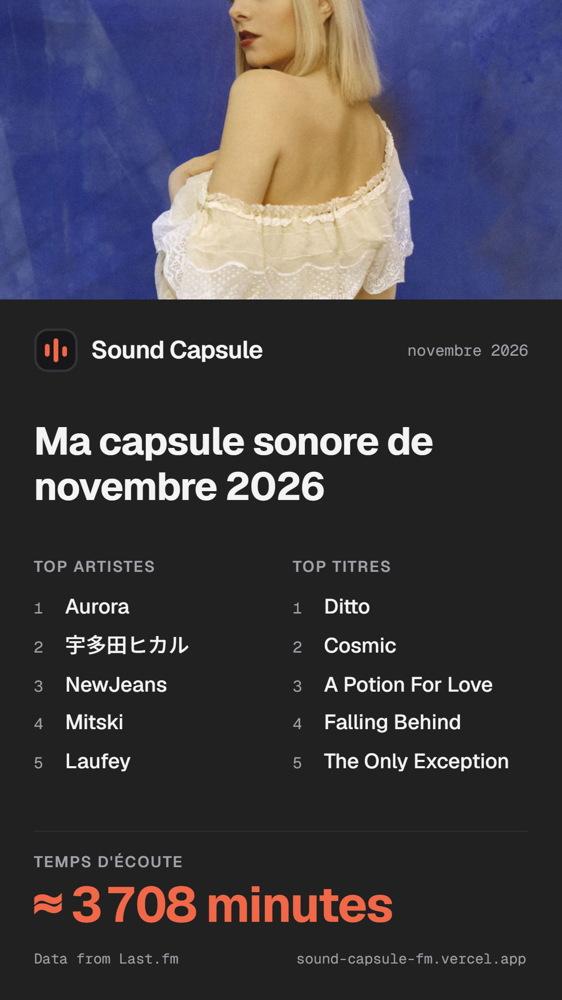

[English](../../README.md) · [Português](README.pt-BR.md) · [Español](README.es.md) · **Français** · [Deutsch](README.de.md) · [Italiano](README.it.md) · [日本語](README.ja.md) · [한국어](README.ko.md) · [简体中文](README.zh-CN.md) · [Русский](README.ru.md) · [Polski](README.pl.md)

# Sound Capsule

Transformez vos scrobbles Last.fm en une **capsule sonore verticale 1080×1920** (format story) prête à être téléchargée ou partagée. L'agrégation se fait entièrement dans le navigateur, sans connexion et sans base de données.

**Déploiement :** <https://sound-capsule-lastfm.vercel.app>



> Carte d'exemple avec des données fictives (photo d'Aurora via Deezer), nom d'utilisateur masqué, thème Ember et 3 708 minutes.

Exemple avec des noms japonais, coréens et chinois rendus dans le PNG exporté : [carte CJK](../screenshots/cjk-1080x1920.png).

## Fonctionnalités

- **Écran d'accueil** avec un champ utilisateur (accepte le nom d'utilisateur ou l'URL du profil), une période (dernière semaine, mois en cours ou plage personnalisée), un aperçu 9:16 et des actions de téléchargement/partage.
- **Période personnalisée d'une durée maximale de 3 mois calendaires** — sans fenêtre fixe de 90 jours et sans restriction sur les dates choisies (de la date d'inscription à Last.fm à aujourd'hui).
- **Carte 9:16** (432×768 en CSS, exportée en PNG 1080×1920) avec les 30 % supérieurs en photo d'artiste et un corps solide `#212121`.
- **Cinq thèmes de couleur fixes** (Ember, Tide, Moss, Plum, Sand) qui ne changent que la couleur d'accent de la carte — pas de sélecteur de couleur libre.
- **Photo d'artiste** en trois couches : correspondance automatique sur Deezer → import local facultatif (jamais envoyé au serveur) → repli canvas avec initiales.
- **Deux colonnes numérotées** (Top artistes et Top titres, 1–5) avec troncature par points de suspension et prise en charge CJK (japonais, coréen et chinois).
- **Temps d'écoute estimé** mis en avant dans la couleur pleine du thème, une infobulle expliquant le calcul et un formatage via `Intl`.
- **Embed autonome** : le bouton « Copier l'embed » génère un bloc HTML `<a></a>` avec le PNG en base64 — sans envoi, sans stockage et sans dépendre d'une URL d'image hébergée (~0,5–0,8 Mo). Fonctionne là où le HTML brut est autorisé.
- **Aperçu de lien** : lorsque vous collez l'URL du site dans WhatsApp, Discord, Twitter/X, Telegram, etc., un titre et une description localisés ainsi qu'une image Open Graph 1200×630 de la marque apparaissent.
- **Progression réelle de la pagination** (« Page 12 sur 40 »), un skeleton dans l'aperçu et une annulation avec `AbortController`.
- **i18n** en `pt`, `en`, `es`, `fr`, `de`, `it`, `ja`, `ko`, `zh`, `ru` et `pl`, avec détection par `Accept-Language`, routes préfixées, textes/dates/nombres formatés avec `Intl` et un menu déroulant de langue personnalisé et accessible.
- **Crédits sur la carte** (« Data from Last.fm », lien du profil et URL du site), avec option pour masquer le nom d'utilisateur de la carte.
- **Fond `<canvas>`** avec de discrètes lignes d'onde qui réagissent à la souris, se mettent en pause quand l'onglet est masqué et se désactivent avec `prefers-reduced-motion`.
- **Accessible** : navigation au clavier, libellés, `role="progressbar"`, alertes, contraste AA et respect de la réduction des animations.
- **Observabilité** : Vercel Web Analytics et Speed Insights, sans cookies, pour suivre les visites et les Core Web Vitals.

## Persistance : uniquement la langue et le thème

| Donnée | Où elle est stockée | Détail |
| --- | --- | --- |
| Langue | cookie `NEXT_LOCALE` | uniquement `pt`, `en`, … |
| Couleur de la carte | `localStorage` (`sound-capsule:theme`) | uniquement l'id de l'accent |
| Nom d'utilisateur, dates, résultat de l'API, photo importée | **mémoire** | perdus au rechargement (F5) |

Changer de langue conserve le nom d'utilisateur et la carte en mémoire (sans nouvelles requêtes vers Last.fm), mais un rechargement efface ces données. Aucune donnée de scrobble, d'historique ou de photo n'est persistée.

## Stack

| Couche | Choix |
| --- | --- |
| Framework | Next.js 15 (App Router) + TypeScript |
| Styles | Tailwind CSS 4 |
| i18n | `next-intl` 4 |
| Export d'image | `html-to-image` (côté client) |
| Tests | Vitest |
| Déploiement | Vercel (serverless, statique + route handlers) |

## Comment ça marche

```text
Navigateur
  ├─ valide l'utilisateur/la période (max. 3 mois calendaires)
  ├─ /api/lastfm  ──────────►  API Last.fm (clé injectée côté serveur)
  │     └─ user.getInfo, user.getRecentTracks, track.getInfo
  ├─ pagine TOUTES les pages de scrobbles (concurrence 3 + temporisation de 150 ms)
  ├─ agrège en mémoire : top artistes, top titres, temps d'écoute
  ├─ /api/artist-image ─────►  recherche Deezer (meilleure correspondance normalisée)
  ├─ /api/image-proxy  ─────►  CDN Deezer (liste d'autorisation *.dzcdn.net)
  ├─ photo utilisateur facultative ─►  canvas local (ne quitte jamais le navigateur)
  └─ rend la carte dans le DOM et exporte un PNG 1080×1920
```

L'application ne récupère pas de données au chargement de la page ; uniquement lorsque l'utilisateur clique sur Générer. Les réponses publiques utilisent le cache CDN avec `Vercel-CDN-Cache-Control` ; un cache hit n'invoque pas la fonction.

## Lancer en local

### Prérequis

- Node.js **20.9+**
- pnpm **9+** (le dépôt a été développé avec pnpm 11)

### 1. Obtenir une clé d'API Last.fm

1. Rendez-vous sur <https://www.last.fm/api/account/create>.
2. Renseignez le nom de l'application (par ex. *Sound Capsule*), l'URL `https://sound-capsule-lastfm.vercel.app` et la description.
3. Copiez la **clé d'API** générée (le *shared secret* n'est pas nécessaire, puisqu'il n'y a pas d'authentification utilisateur).

### 2. Configurer l'environnement

```bash
cp .env.example .env.local
# modifiez .env.local et renseignez :
LASTFM_API_KEY=your_key_here
```

La variable est **réservée au serveur**. N'utilisez jamais le préfixe `NEXT_PUBLIC_`, et elle ne fait pas partie du bundle client.

### 3. Installer et lancer

```bash
pnpm install
pnpm dev
```

Ouvrez <http://localhost:3000> — le middleware redirige vers la langue détectée à partir de `Accept-Language` (ou du cookie `NEXT_LOCALE`).

### Scripts

| Commande | Description |
| --- | --- |
| `pnpm dev` | serveur de développement |
| `pnpm build` | build de production |
| `pnpm start` | sert le build de production |
| `pnpm test` | tests unitaires (Vitest) |
| `pnpm test:watch` | tests en mode watch |
| `pnpm typecheck` | vérification des types avec `tsc --noEmit` |

## Déploiement sur Vercel

Le déploiement actuel est à l'adresse <https://sound-capsule-lastfm.vercel.app>.

1. Poussez le projet dans un dépôt GitHub/GitLab/Bitbucket.
2. Dans Vercel, cliquez sur **Add New → Project** et importez le dépôt.
3. Le preset **Next.js** est détecté automatiquement. Confirmez :
   - Install Command: `pnpm install`
   - Build Command: `pnpm build`
   - Output: valeur par défaut de Next.js
4. Sous **Settings → Environment Variables**, ajoutez `LASTFM_API_KEY` en Production (et, pour tester les previews, également en Preview/Development).
5. Déployez. Il n'y a ni base de données, ni migrations, ni cron jobs, ni stockage à configurer.
6. Facultatif : configurez un domaine personnalisé sous **Settings → Domains**.

Le projet a été conçu pour le plan **Hobby** (personnel/non commercial) : chaque capsule typique effectue ~60–176 invocations de fonction, et le cache CDN évite de répéter les appels stables. L'import de photo est 100 % local, il ne consomme donc ni fonction, ni bande passante, ni la limite de corps de 4,5 Mo de Vercel.

Notes de production :

- Les route handlers utilisent `AbortSignal.timeout(10s)` pour l'upstream ; chaque appel est court et indépendant.
- `track.getInfo` et les images restent 24 h dans le CDN ; les données utilisateur restent 1–5 min. Les erreurs ne sont jamais mises en cache.
- Le proxy d'images répond en mode streaming afin de ne pas atteindre la limite de 4,5 Mo des réponses non streamées.
- Les polices CJK sont auto-hébergées par `next/font` pendant le build ; l'environnement doit pouvoir accéder à Google Fonts.

## Structure

```text
app/
  [locale]/
    layout.tsx            # layout racine : polices, fournisseur i18n, metadata/SEO
    page.tsx              # écran d'accueil (serveur) + CapsuleStudio (client)
    [...rest]/page.tsx    # routes inconnues → notFound()
  api/
    lastfm/route.ts       # proxy avec liste d'autorisation des méthodes et paramètres
    artist-image/route.ts # recherche Deezer + correspondance normalisée
    image-proxy/route.ts  # proxy d'images (liste d'autorisation + streaming)
  robots.ts               # robots.txt (bloque /api/, pointe vers le sitemap)
  sitemap.ts              # sitemap des 11 routes avec alternates
  globals.css             # tokens de design (Tailwind 4)
  icon.svg                # marque/favicon
components/
  CapsuleStudio.tsx       # formulaire, thème, import, progression, export/share/embed
  CapsuleCard.tsx         # carte 432×768 avec crédits et thème
  CardHero.tsx            # photo d'artiste/import ou repli canvas
  BackgroundCanvas.tsx    # ondes de fond (souris, reduced motion, masqué)
  SiteHeader.tsx / SiteFooter.tsx / BrandMark.tsx
  LocaleSwitcher.tsx      # menu déroulant de langue personnalisé et accessible
i18n/                     # routing/request/navigation de next-intl
lib/
  lastfmClient.ts         # pagination, concurrence, temporisation, retry/backoff, abort
  aggregate.ts            # agrégation et estimation des minutes (testé)
  periods.ts              # intervalles, limite de 3 mois, Intl
  artistMatch.ts          # correspondance normalisée Deezer
  artistImage.ts          # résolution/préchargement de la photo principale
  localPhoto.ts           # validation/redimensionnement local de la photo importée
  cardThemes.ts           # accents fixes et persistance uniquement de l'id
  studioSession.ts        # état en mémoire pour changer de langue
  site.ts / httpCache.ts  # URL/User-Agent et en-têtes de cache
  exportCard.ts           # intégration des polices + html-to-image → PNG 1080×1920
  initials.ts / locales.ts
public/
  og/<locale>.png          # aperçu Open Graph/Twitter 1200×630
  llms.txt                # résumé du projet pour agents/LLM
messages/                 # pt, en, es, fr, de, it, ja, ko, zh, ru, pl
tests/                    # Vitest
../screenshots/         # captures de référence
```

## Aperçu de lien, SEO et découverte

- `metadataBase` + Open Graph/Twitter Card sur les 11 routes, avec titre et description localisés.
- Image `public/og/<locale>.png` (1200×630) utilisée dans `og:image` et `twitter:image` ; c'est l'aperçu affiché lorsque le lien est collé dans WhatsApp, Discord, Telegram, Twitter/X, etc.
- `/robots.txt` généré par `app/robots.ts`, autorisant le site, bloquant `/api/` et pointant vers le sitemap.
- `/sitemap.xml` généré par `app/sitemap.ts`, avec les 11 routes et les alternates `hreflang`.
- `/llms.txt` avec un résumé factuel du produit, des sources de données et de la politique de confidentialité destiné aux agents IA.

## Décisions techniques

### Pourquoi `user.getRecentTracks` plutôt que `user.getTopTracks` ?

`getTopTracks`/`getTopArtists` n'acceptent que des fenêtres fixes (`7day`, `1month`…), et le « mois » de Last.fm n'est pas le mois calendaire courant. L'application pagine `user.getRecentTracks` avec `from`/`to` (unix) et agrège localement, garantissant que **« mois en cours »** corresponde exactement du jour 1 à maintenant dans le fuseau horaire du visiteur.

- `limit=200` par page ; la première page découvre `totalPages`.
- Les pages restantes s'exécutent en parallèle avec **une concurrence de 3**, avec une **temporisation de 150 ms entre les appels** pour respecter les recommandations d'usage de Last.fm.
- Nouvelle tentative avec **backoff exponentiel** pour l'erreur 29 (rate limit), les 5xx et les échecs réseau.
- Le titre « now playing » (`@attr.nowplaying`) est ignoré.
- Le bouton **Annuler** annule toutes les requêtes en cours (`AbortController`).

### Temps d'écoute

Last.fm n'expose pas le temps d'écoute. L'estimation :

1. Récupère la durée réelle (`track.getInfo` → `duration` en ms) pour les **50 titres les plus écoutés** (concurrence 3).
2. Les titres sans durée, avec une durée de 0 ou hors du top 50 utilisent **3,5 min (210 s)**.
3. `minutes = arrondir(Σ durée × scrobbles / 60,000)`.

L'interface affiche la valeur comme approximative (`≈ 66 minutes`) et l'infobulle explique le calcul. Le repli et la limite du top 50 sont configurables dans `lib/periods.ts`.

### Photo d'artiste

Last.fm ne renvoie plus de vraies photos (placeholder). L'application appelle Deezer, choisit le résultat avec la meilleure similarité normalisée et privilégie la **correspondance exacte la plus populaire** parmi les noms en double — sans cela, un « Twice » obscur pourrait apparaître à la place de TWICE. L'utilisateur peut aussi importer une photo locale (JPEG/PNG/WebP, jusqu'à 10 Mo) : elle est redimensionnée sur le canvas et utilisée uniquement dans la mémoire du navigateur. Si rien n'est trouvé, la carte utilise le repli procédural en canvas.

### Thèmes

Cinq accents fixes dans `lib/cardThemes.ts` ; seule la couleur d'accent de la carte change (marque et temps d'écoute). L'id choisi est la seule donnée de thème enregistrée, dans `localStorage`. Le site lui-même reste neutre.

### État entre les langues

`CapsuleStudio` conserve les données non localisées dans un store en mémoire (`lib/studioSession.ts`). Lors d'un changement de langue, le composant est remonté, s'hydrate depuis le store et ne recalcule que les textes avec la nouvelle locale — **zéro requête vers Last.fm**. La langue elle-même est persistée dans le cookie `NEXT_LOCALE`.

### Export 1080×1920

`html-to-image` rend la carte (432×768) avec `pixelRatio: 2.5`. Avant l'export :

- `document.fonts.ready` + deux frames de layout ;
- chaque `` de la carte est décodée ;
- une intégration de polices sur mesure inclut **uniquement les sous-ensembles dont `unicode-range` recoupe les caractères de la carte**, évitant de télécharger des mégaoctets de tranches CJK inutiles.

Le PNG final fait exactement **1080×1920** (vérifié dans un navigateur, y compris avec une photo importée par l'utilisateur).

### Design

Palette neutre, une seule couleur d'accent solide par carte, sans néon/dégradé/glassmorphism :

| Token | Valeur |
| --- | --- |
| Fond | `#0f0f10` |
| Surface du formulaire | `#171719` |
| Champs | `#111113` |
| Corps de la carte | `#212121` |
| Accents | Ember `#F06848`, Tide `#5B9DFF`, Moss `#7ED08A`, Plum `#C084FC`, Sand `#E7C27A` |
| Texte | `#f4f4f5` / atténué `#a1a1aa` |

Typographie : Geist (sans) + Geist Mono (chiffres/détails) + Noto Sans JP/KR/SC pour le CJK.

## Confidentialité, sécurité et TOS

- `LASTFM_API_KEY` n'existe que sur le serveur ; le client ne la reçoit jamais.
- `/api/lastfm` n'accepte que `user.getInfo`, `user.getRecentTracks` et `track.getInfo` ; il rejette `api_key`/`format` envoyés par le client, valide les entiers (plages et limites), le nom d'utilisateur et les caractères de contrôle.
- `/api/image-proxy` n'accepte que les URL `https` sur `*.dzcdn.net`, revalide l'hôte après les redirections, exige `Content-Type: image/*` et répond en mode streaming.
- L'application envoie un User-Agent identifiable à Last.fm/Deezer.
- Attribution conformément aux [TOS de Last.fm](https://www.last.fm/api/tos) : un lien « powered by Last.fm » dans le pied de page et les crédits « Data from Last.fm », profil et URL du site sur la carte exportée.
- **Seules données persistées** : la langue (cookie) et l'accent de la carte (`localStorage`). Il n'y a ni base de données, ni stockage de scrobbles, ni connexion, ni cookies de session.
- Rien de l'historique de l'utilisateur n'est enregistré dans les logs de l'application. Le projet est personnel et non commercial.

### Observabilité

- Vercel Web Analytics (`@vercel/analytics`) et Speed Insights (`@vercel/speed-insights`) sont installés dans le layout de locale.
- Les deux sont sans cookies : ils ne collectent ni noms d'utilisateur, ni données de carte, ni données de scrobble.
- Sur le plan Hobby, Web Analytics inclut 50 000 événements/mois et Speed Insights inclut 10 000 événements sur les 30 derniers jours ; les deux sont gratuits dans ces limites, et la collecte s'arrête au lieu de facturer le dépassement.

## i18n

- Locales : `pt` (par défaut, contenu pt-BR), `en`, `es`, `fr`, `de`, `it`, `ja`, `ko`, `zh` (chinois simplifié), `ru` et `pl`.
- Détection via `Accept-Language` dans le middleware (le cookie `NEXT_LOCALE` est prioritaire) ; le changement manuel dans l'en-tête préserve la route et la carte en mémoire. Le sélecteur est un menu déroulant personnalisé, pas le `<select>` natif.
- Les dates et les nombres utilisent `Intl` avec la locale régionale correcte (`pt-BR`, `en-US`, `es-ES`, `fr-FR`, `de-DE`, `it-IT`, `ja-JP`, `ko-KR`, `zh-CN`, `ru-RU`, `pl-PL`).
- Le texte de la carte est traduit avec l'interface ; l'image exportée utilise déjà la langue active.
- Polices : Geist charge latin/latin-ext/cyrillique ; Noto Sans JP/KR/SC couvre les caractères CJK de la carte.

## Tests

```bash
pnpm test        # 108 tests unitaires
pnpm typecheck
pnpm build
```

Couverture actuelle :

- normalisation des URL de profil collées dans le champ utilisateur ;
- agrégation des scrobbles, tie-breakers, CJK et calcul du temps d'écoute ;
- intervalles de période, la limite de **3 mois calendaires**, février/mois de 31 jours, inscription, futur et `Intl` ;
- client Last.fm avec `fetch` simulé : pagination, now playing, retry 29/réseau, abort, durées du top 50, erreurs 6/17, date d'inscription (`unixtime`) ;
- correspondance d'artistes Deezer (y compris le départage par popularité entre noms en double) ;
- routes API : liste d'autorisation, clé serveur, User-Agent, en-têtes de cache, streaming du proxy d'images ;
- thèmes et store de session ;
- validation de l'import local (type/taille).

En outre, le flux a été vérifié dans Chromium avec Last.fm/Deezer simulés : thème, import, crédits, nom d'utilisateur masqué, embed autonome (presse-papiers), changement de langue sans nouvelles requêtes, menu déroulant personnalisé (souris, clavier et clic extérieur), routes `ko`/`ru`/`zh`/`pl`, défilement automatique vers l'aperçu sur mobile, seuls cookie/localStorage autorisés, F5, validation de 3 mois et export **1080×1920**. Le flux réel a également été exécuté contre l'API Last.fm/Deezer avec un profil actif.

## Limitations connues

- **Période maximale de 3 mois calendaires** : conçue pour rester dans l'usage raisonnable de Last.fm et du plan Hobby. Des récaps annuels nécessiteraient une autre architecture/limite.
- **Le temps d'écoute est une estimation** : il dépend des durées de `track.getInfo` et du repli de 210 s ; les titres live/remix peuvent diverger.
- **Les photos viennent de Deezer** : la correspondance par nom peut échouer pour des artistes homonymes ou ne rien trouver (le repli canvas est alors utilisé). Les noms dans un autre alphabet (par ex. 南翔子, indexé comme « Shoko Minami ») peuvent ne correspondre à rien. L'import local couvre ces cas.
- **Les imports ne sont pas persistés** : la photo n'existe qu'en mémoire et disparaît au F5, comme le résultat et le nom d'utilisateur.
- **Les profils privés** (« hide recent listening ») renvoient l'erreur 17 ; l'application explique comment l'activer.
- **L'export côté client** dépend du navigateur (testé dans Chromium). Sur les appareils anciens/Safari avec peu de mémoire, le PNG peut échouer ; un message d'erreur est affiché.
- **La Web Share API** n'est pas disponible dans tous les navigateurs ; dans ce cas, l'application télécharge le PNG.
- La carte ne rend les photos et les polices qu'une fois chargées ; l'aperçu attend le chargement avant d'activer le PNG.

## Dépannage

| Symptôme | Cause probable / solution |
| --- | --- |
| « Il manque la clé d'API au serveur » | `LASTFM_API_KEY` absente de `.env.local` (ou sur Vercel) ; redémarrez le serveur. |
| « Utilisateur introuvable » | nom d'utilisateur invalide ou inexistant ; vérifiez-le sur `last.fm/user/<name>`. |
| « Scrobbles privés » | activez « Afficher l'écoute récente » dans les paramètres de confidentialité de Last.fm. |
| « Aucun scrobble sur la période » | la période choisie n'a pas d'historique public. |
| « Rate limit » | attendez et réessayez ; l'application applique déjà une temporisation et un backoff. |
| Aperçu sans photo | Deezer n'a pas trouvé l'artiste ; importez une photo ou utilisez le repli géométrique. |
| « Utilisez JPEG, PNG ou WebP » / « 10 Mo maximum » | format/taille de la photo locale hors de la plage autorisée. |
| Les polices CJK n'apparaissent pas | vérifiez que le build a pu télécharger Noto Sans JP/KR/SC depuis Google Fonts. |
| Le build échoue sur `prerender /404` | symptôme de `node_modules` corrompu ; supprimez `node_modules` et relancez `pnpm install`. |

## Avertissement

Sound Capsule est un projet indépendant, non affilié à Last.fm ni à aucun service de streaming. Les données musicales sont publiques et fournies par l'API Last.fm ; les photos d'artistes proviennent de Deezer ou de l'utilisateur. L'utilisation du plan Hobby de Vercel est personnelle et non commerciale.

## Crédits

Créé par [Ranieeery](https://github.com/Ranieeery).

