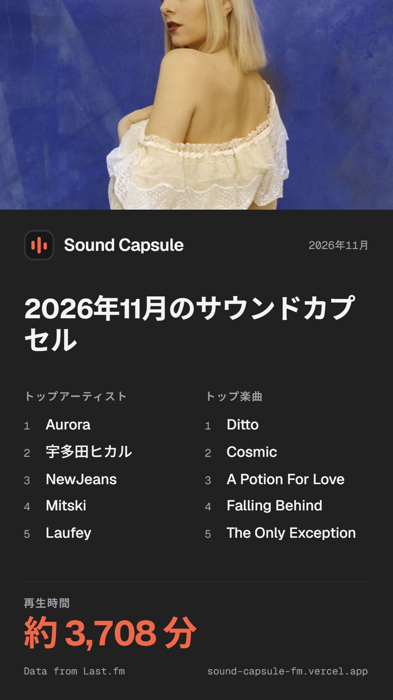

[English](../../README.md) · [Português](README.pt-BR.md) · [Español](README.es.md) · [Français](README.fr.md) · [Deutsch](README.de.md) · [Italiano](README.it.md) · **日本語** · [한국어](README.ko.md) · [简体中文](README.zh-CN.md) · [Русский](README.ru.md) · [Polski](README.pl.md)

# Sound Capsule

Last.fmのスクロブルを、ダウンロードや共有がすぐにできる**縦型1080×1920のサウンドカプセル**（ストーリーズ形式）に変換します。集計はすべてブラウザ内で完結し、ログインもデータベースも不要です。

**デプロイ:** <https://sound-capsule-fm.vercel.app>



> デモデータのサンプルカード（Auroraの写真はDeezerから）、ユーザー名非表示、Emberテーマ、3,708分。


## 機能

- **ホーム画面**：ユーザー入力（ユーザー名またはプロフィールURL）、期間（過去7日間・今月・カスタム範囲）、9:16のプレビュー、ダウンロード／共有アクションを備えています。
- **最長3か月（暦月）のカスタム期間** — 固定の90日ウィンドウはなく、選択した日付も制限されません（Last.fmの登録日から今日まで）。
- **9:16カード**（CSSで432×768、書き出しは1080×1920 PNG）で、上部30%がアーティスト写真、本文は`#212121`のベタ塗りです。
- **5つの固定カラーテーマ**（Ember、Tide、Moss、Plum、Sand）はカードのアクセントだけを変更します — 自由なカラーピッカーはありません。
- **アーティスト写真**は3層構成：Deezerでの自動マッチ → 任意のローカルアップロード（サーバーには送信されません） → イニシャルによるキャンバスフォールバック。
- **番号付きの2列**（トップアーティストとトップ楽曲、1〜5）で、省略記号による切り詰めとCJK（日本語・韓国語・中国語）に対応しています。
- **推定再生時間**をテーマのベタ色で強調表示し、計算方法を説明するツールチップを表示、書式は`Intl`で整形します。
- **自己完結型の埋め込み**：「埋め込みコードをコピー」ボタンは、PNGをbase64で埋め込んだHTMLの`<a></a>`ブロックを生成します — アップロードもストレージも不要で、ホストされた画像URLにも依存しません（約0.5〜0.8 MB）。生のHTMLが許可される場所で動作します。
- **リンクプレビュー**：サイトのURLをWhatsApp、Discord、Twitter/X、Telegramなどに貼り付けると、ローカライズされたタイトルと説明、ブランド入りの1200×630のOpen Graph画像が表示されます。
- **実際のページ送り進捗**（「40ページ中12ページ」）、プレビューのスケルトン、`AbortController`によるキャンセルに対応しています。
- **i18n**：`pt`、`en`、`es`、`fr`、`de`、`it`、`ja`、`ko`、`zh`、`ru`、`pl`に対応し、`Accept-Language`による検出、プレフィックス付きルート、`Intl`によるテキスト・日付・数値の整形、カスタムでアクセシブルな言語ドロップダウンを備えています。
- **カードのクレジット**（「Data from Last.fm」、プロフィールへのリンク、サイトURL）があり、カードからユーザー名を隠すオプションもあります。
- **`<canvas>`背景**：マウスに反応する控えめな波形ラインが表示され、タブが非表示になると一時停止し、`prefers-reduced-motion`でオフになります。
- **アクセシブル**：キーボードナビゲーション、ラベル、`role="progressbar"`、アラート、AAコントラスト、モーション低減への配慮。
- **可観測性**：Cookieを使わないVercel Web AnalyticsとSpeed Insightsで、訪問数とCore Web Vitalsを追跡します。

## 永続化：言語とテーマのみ

| データ | 保存場所 | 詳細 |
| --- | --- | --- |
| 言語 | `NEXT_LOCALE` Cookie | `pt`、`en`、…のみ |
| カードの色 | `localStorage`（`sound-capsule:theme`） | アクセントIDのみ |
| ユーザー名、日付、API結果、アップロードした写真 | **メモリ** | F5で消去 |

言語を切り替えてもメモリ上のユーザー名とカードは保持されます（Last.fmへの新しいリクエストは発生しません）が、リロードするとこれらのデータは消去されます。スクロブル、履歴、写真のデータは一切永続化されません。

## スタック

| レイヤー | 採用技術 |
| --- | --- |
| フレームワーク | Next.js 15（App Router）+ TypeScript |
| スタイリング | Tailwind CSS 4 |
| i18n | `next-intl` 4 |
| 画像の書き出し | `html-to-image`（クライアントサイド） |
| テスト | Vitest |
| デプロイ | Vercel（serverless、静的 + route handlers） |

## 仕組み

```text
ブラウザ
  ├─ ユーザーと期間を検証（最大3か月）
  ├─ /api/lastfm  ──────────►  Last.fm API（キーはサーバー側で注入）
  │     └─ user.getInfo, user.getRecentTracks, track.getInfo
  ├─ すべてのスクロブルページをページ送り（同時実行3 + 150 msのペーサー）
  ├─ メモリ上で集計：トップアーティスト、トップ楽曲、再生時間
  ├─ /api/artist-image ─────►  Deezer検索（最良の正規化マッチ）
  ├─ /api/image-proxy  ─────►  Deezer CDN（許可リスト *.dzcdn.net）
  ├─ 任意のユーザー写真 ───►  ローカルキャンバス（ブラウザの外には出ません）
  └─ DOMにカードを描画し、1080×1920のPNGを書き出す
```

アプリはページ読み込み時にはデータを取得せず、ユーザーが「カプセルを作成」をクリックしたときにだけ取得します。公開レスポンスは`Vercel-CDN-Cache-Control`によるCDNキャッシュを使用し、キャッシュヒット時に関数は呼び出されません。

## ローカルでの実行

### 要件

- Node.js **20.9+**
- pnpm **9+**（リポジトリはpnpm 11で開発されました）

### 1. Last.fm APIキーを取得する

1. <https://www.last.fm/api/account/create>にアクセスします。
2. アプリ名（例：*Sound Capsule*）、URL `https://sound-capsule-fm.vercel.app`、説明を入力します。
3. 生成された**APIキー**をコピーします（ユーザー認証がないため、*shared secret*は不要です）。

### 2. 環境を設定する

```bash
cp .env.example .env.local
# .env.localを編集して次を入力します：
LASTFM_API_KEY=your_key_here
```

この変数は**サーバー専用**です。`NEXT_PUBLIC_`プレフィックスは絶対に使用せず、クライアントバンドルにも含まれません。

### 3. インストールして実行する

```bash
pnpm install
pnpm dev
```

<http://localhost:3000>を開きます — ミドルウェアが`Accept-Language`（または`NEXT_LOCALE` Cookie）から検出したロケールへリダイレクトします。

### スクリプト

| コマンド | 説明 |
| --- | --- |
| `pnpm dev` | 開発サーバー |
| `pnpm build` | 本番ビルド |
| `pnpm start` | 本番ビルドを配信 |
| `pnpm test` | ユニットテスト（Vitest） |
| `pnpm test:watch` | ウォッチモードでのテスト |
| `pnpm typecheck` | `tsc --noEmit`による型チェック |

## Vercelへのデプロイ

現在のデプロイ先は<https://sound-capsule-fm.vercel.app>です。

1. プロジェクトをGitHub/GitLab/Bitbucketのリポジトリにプッシュします。
2. Vercelで**Add New → Project**をクリックし、リポジトリをインポートします。
3. **Next.js**プリセットが自動検出されます。以下を確認します：
   - Install Command: `pnpm install`
   - Build Command: `pnpm build`
   - Output: Next.jsのデフォルト
4. **Settings → Environment Variables**で、Productionに`LASTFM_API_KEY`を追加します（プレビューをテストする場合はPreview/Developmentにも追加します）。
5. デプロイします。データベース、マイグレーション、cronジョブ、ストレージの設定は不要です。
6. 任意：**Settings → Domains**でカスタムドメインを設定します。

このプロジェクトは**Hobby**プラン（個人・非商用）向けに設計されています。一般的なカプセル1枚で約60–176回の関数呼び出しが発生しますが、CDNキャッシュにより安定した呼び出しの繰り返しを避けています。写真のアップロードは100%ローカルなので、関数も帯域幅もVercelの4.5 MBボディ上限も消費しません。

本番環境の注意点：

- ルートハンドラは上流に対して`AbortSignal.timeout(10s)`を使用しています。各呼び出しは短時間で独立しています。
- `track.getInfo`と画像はCDNに24時間保持され、ユーザーデータは1〜5分保持されます。エラーはキャッシュされません。
- 画像プロキシはストリーミングモードで応答するため、4.5 MBの非ストリーミングレスポンス上限に抵触しません。
- CJKフォントはビルド時に`next/font`がセルフホストします。環境はGoogle Fontsにアクセスできる必要があります。

## 構成

```text
app/
  [locale]/
    layout.tsx            # ルートレイアウト：フォント、i18nプロバイダー、メタデータ/SEO
    page.tsx              # ホーム画面（サーバー）+ CapsuleStudio（クライアント）
    [...rest]/page.tsx    # 未知のルート → notFound()
  api/
    lastfm/route.ts       # メソッドとパラメータの許可リスト付きプロキシ
    artist-image/route.ts # Deezer検索 + 正規化マッチング
    image-proxy/route.ts  # 画像プロキシ（許可リスト + ストリーミング）
  robots.ts               # robots.txt（/api/をブロックし、サイトマップを指す）
  sitemap.ts              # 11ルートのサイトマップ（alternates付き）
  globals.css             # デザイントークン（Tailwind 4）
  icon.svg                # ブランド/favicon
components/
  CapsuleStudio.tsx       # フォーム、テーマ、アップロード、進捗、エクスポート/共有/埋め込み
  CapsuleCard.tsx         # クレジットとテーマ付きの432×768カード
  CardHero.tsx            # アーティスト写真/アップロードまたはキャンバスフォールバック
  BackgroundCanvas.tsx    # 背景の波形（マウス、モーション低減、非表示）
  SiteHeader.tsx / SiteFooter.tsx / BrandMark.tsx
  LocaleSwitcher.tsx      # カスタムでアクセシブルな言語ドロップダウン
i18n/                     # next-intlのルーティング/リクエスト/ナビゲーション
lib/
  lastfmClient.ts         # ページ送り、同時実行、ペーサー、リトライ/バックオフ、中断
  aggregate.ts            # 集計と分単位の推定（テスト済み）
  periods.ts              # 期間、3か月制限、Intl
  artistMatch.ts          # 正規化されたDeezerマッチング
  artistImage.ts          # ヒーロー写真の解決/プリロード
  localPhoto.ts           # アップロード写真のローカル検証/リサイズ
  cardThemes.ts           # 固定アクセントとIDのみの永続化
  studioSession.ts        # 言語切り替え用のインメモリ状態
  site.ts / httpCache.ts  # URL/User-Agentとキャッシュヘッダー
  exportCard.ts           # フォント埋め込み + html-to-image → 1080×1920 PNG
  initials.ts / locales.ts
public/
  og/<locale>.png          # Open Graph/Twitterプレビュー 1200×630
  llms.txt                # エージェント/LLM向けのプロジェクト概要
messages/                 # pt, en, es, fr, de, it, ja, ko, zh, ru, pl
tests/                    # Vitest
../screenshots/         # リファレンスのスクリーンショット
```

## リンクプレビュー、SEO、発見性

- 11ルートすべてに`metadataBase` + Open Graph/Twitter Cardを設定し、タイトルと説明をローカライズしています。
- `og:image`と`twitter:image`には`public/og/<locale>.png`の画像（1200×630）を使用します。これはWhatsApp、Discord、Telegram、Twitter/Xなどにリンクを貼り付けたときに表示されるプレビューです。
- `/robots.txt`は`app/robots.ts`が生成し、サイトを許可し、`/api/`をブロックし、サイトマップを指します。
- `/sitemap.xml`は`app/sitemap.ts`が生成し、11ルートと`hreflang`のalternatesを含みます。
- `/llms.txt`には、AIエージェント向けに製品・データソース・プライバシーポリシーの事実に基づく概要を掲載しています。

## 技術的な判断

### なぜ`user.getTopTracks`ではなく`user.getRecentTracks`なのか？

`getTopTracks`/`getTopArtists`は固定のウィンドウ（`7day`、`1month`など）しか受け付けず、Last.fmの「月」は現在の暦月ではありません。アプリは`from`/`to`（unix）を指定して`user.getRecentTracks`をページ送りし、ローカルで集計することで、**「今月」**が訪問者のタイムゾーンにおける1日から現在までと正確に一致することを保証します。

- 1ページあたり`limit=200`。最初のページで`totalPages`を取得します。
- 残りのページは**同時実行3**で並列に実行し、Last.fmの利用ガイドラインに収めるため**呼び出し間に150 msのペーサー**を入れます。
- エラー29（レート制限）、5xx、ネットワーク障害では**指数バックオフ**でリトライします。
- 「再生中」のトラック（`@attr.nowplaying`）は無視します。
- **キャンセル**ボタンは実行中のすべてのリクエストを中断します（`AbortController`）。

### 再生時間

Last.fmは再生時間を公開していません。推定方法は次のとおりです。

1. **最も再生回数の多い50曲**について、実際の長さ（`track.getInfo` → `duration`、ミリ秒）を取得します（同時実行3）。
2. 長さがない曲、長さが0の曲、トップ50外の曲は**3.5分（210秒）**として扱います。
3. `minutes = round(Σ duration × scrobbles / 60,000)`。

UIは値を概算として表示し（`約 66 分`）、ツールチップで計算方法を説明します。フォールバックとトップ50の制限は`lib/periods.ts`で設定可能です。

### アーティスト写真

Last.fmは実写真を返さなくなりました（プレースホルダー）。アプリはDeezerを呼び出し、正規化した類似度が最も高い結果を選択し、重複する名前の中では**最も人気のある完全一致**を優先します — これがないと、TWICEの代わりに無名の「Twice」が表示される可能性があります。ユーザーはローカル写真（JPEG/PNG/WebP、最大10 MB）をアップロードすることもでき、キャンバス上でリサイズされ、ブラウザのメモリ内でのみ使用されます。何も見つからない場合、カードはプロシージャルなキャンバスフォールバックを使用します。

### テーマ

`lib/cardThemes.ts`の5つの固定アクセントで、変わるのはカードのアクセントカラー（ブランドと再生時間）だけです。保存されるテーマデータは選択したIDのみで、`localStorage`に保存されます。サイト自体はニュートラルなままです。

### 言語をまたぐ状態

`CapsuleStudio`はローカライズされていないデータをインメモリストア（`lib/studioSession.ts`）に保持します。言語を切り替えるとコンポーネントは再マウントし、ストアからハイドレートして、新しいロケールでテキストだけを再計算します — **Last.fmへのリクエストはゼロ**です。言語自体は`NEXT_LOCALE` Cookieに永続化されます。

### 1080×1920の書き出し

`html-to-image`はカード（432×768）を`pixelRatio: 2.5`でレンダリングします。書き出しの前に：

- `document.fonts.ready` + 2回のレイアウトフレーム；
- カード内のすべての``をデコード；
- 特注のフォント埋め込みは、**`unicode-range`がカード内の文字と交差するサブセットのみ**を含め、不要なCJKスライスの数MBのダウンロードを避けます。

最終的なPNGは正確に**1080×1920**です（ユーザーがアップロードした写真を含め、ブラウザで検証済み）。

### デザイン

ニュートラルなパレット、カードごとに1つのベタ塗りアクセントカラー、ネオン/グラデーション/グラスモーフィズムは使いません：

| トークン | 値 |
| --- | --- |
| 背景 | `#0f0f10` |
| フォームの面 | `#171719` |
| 入力欄 | `#111113` |
| カード本体 | `#212121` |
| アクセント | Ember `#F06848`、Tide `#5B9DFF`、Moss `#7ED08A`、Plum `#C084FC`、Sand `#E7C27A` |
| テキスト | `#f4f4f5` / ミュート `#a1a1aa` |

タイポグラフィ：Geist（サンセリフ）+ Geist Mono（数値/詳細）+ CJK用のNoto Sans JP/KR/SC。

## プライバシー、セキュリティ、利用規約

- `LASTFM_API_KEY`はサーバーにのみ存在し、クライアントが受け取ることはありません。
- `/api/lastfm`は`user.getInfo`、`user.getRecentTracks`、`track.getInfo`のみを受け付け、クライアントから送信された`api_key`/`format`を拒否し、整数（範囲と上限）、ユーザー名、制御文字を検証します。
- `/api/image-proxy`は`*.dzcdn.net`上の`https` URLのみを受け付け、リダイレクト後にホストを再検証し、`Content-Type: image/*`を必須とし、ストリーミングモードで応答します。
- アプリはLast.fm/Deezerに識別可能なUser-Agentを送信します。
- [Last.fm TOS](https://www.last.fm/api/tos)に基づく帰属表示：フッターの「powered by Last.fm」リンクと、書き出したカードの「Data from Last.fm」、プロフィール、サイトURLのクレジット。
- **永続化されるデータのみ**：言語（Cookie）とカードのアクセント（`localStorage`）。データベース、スクロブルの保存、ログイン、セッションCookieはありません。
- ユーザーの履歴からアプリのログに記録されるものはありません。このプロジェクトは個人向けかつ非商用です。

### 可観測性

- Vercel Web Analytics（`@vercel/analytics`）とSpeed Insights（`@vercel/speed-insights`）がロケールレイアウトに導入されています。
- どちらもCookieを使用せず、ユーザー名、カードデータ、スクロブルデータを収集しません。
- Hobbyでは、Web Analyticsは月間50,000イベント、Speed Insightsは過去30日間で10,000イベントを含みます。いずれも上限内は無料で、超過分は課金されず収集が一時停止します。

## i18n

- ロケール：`pt`（デフォルト、pt-BRコンテンツ）、`en`、`es`、`fr`、`de`、`it`、`ja`、`ko`、`zh`（簡体字中国語）、`ru`、`pl`。
- ミドルウェアの`Accept-Language`による検出（`NEXT_LOCALE` Cookieが優先）；ヘッダーでの手動切り替えはルートとメモリ上のカードを保持します。セレクターはネイティブの`<select>`ではなくカスタムドロップダウンです。
- 日付と数値は、正しい地域ロケール（`pt-BR`、`en-US`、`es-ES`、`fr-FR`、`de-DE`、`it-IT`、`ja-JP`、`ko-KR`、`zh-CN`、`ru-RU`、`pl-PL`）で`Intl`を使用します。
- カードのテキストはインターフェースとともに翻訳され、書き出した画像はすでに有効な言語を使用しています。
- フォント：Geistはラテン/ラテン拡張/キリル文字を読み込み、Noto Sans JP/KR/SCはカード内のCJK文字をカバーします。

## テスト

```bash
pnpm test        # 108個のユニットテスト
pnpm typecheck
pnpm build
```

現在のカバレッジ：

- ユーザー欄に貼り付けられたプロフィールURLの正規化；
- スクロブルの集計、タイブレーカー、CJK、再生時間の計算；
- 期間のインターバル、**暦月で3か月**の上限、2月/31日の月、登録日、未来、`Intl`；
- `fetch`をモックしたLast.fmクライアント：ページ送り、再生中、リトライ29/ネットワーク、中断、トップ50の長さ、エラー6/17、登録日（`unixtime`）；
- Deezerのアーティストマッチング（重複する名前の中での人気によるタイブレークを含む）；
- APIルート：許可リスト、サーバーキー、User-Agent、キャッシュヘッダー、画像プロキシのストリーミング；
- テーマとセッションストア；
- ローカルアップロードの検証（タイプ/サイズ）。

さらに、シミュレーションしたLast.fm/DeezerでChromium上でフローを検証しました：テーマ、アップロード、クレジット、ユーザー名の非表示、自己完結型の埋め込み（クリップボード）、新しいリクエストなしの言語切り替え、カスタムドロップダウン（マウス、キーボード、外側のクリック）、`ko`/`ru`/`zh`/`pl`ルート、モバイルでのプレビューへの自動スクロール、Cookie/localStorageのみの許可、F5、3か月の検証、**1080×1920**の書き出し。実際のフローは、アクティブなプロフィールを使ってLast.fm/Deezer APIに対しても実行しました。

## 既知の制限

- **最長3か月（暦月）の期間**：Last.fmの妥当な利用とHobbyプランに収まるように設計されています。年間の振り返りには別のアーキテクチャ/制限が必要です。
- **再生時間は推定値**：`track.getInfo`の長さと210秒のフォールバックに依存するため、ライブトラックやリミックスでは乖離することがあります。
- **写真はDeezerから取得**：名前のマッチングは同名アーティストで失敗したり、何も見つからないことがあります（その場合はキャンバスフォールバックを使用）。別の文字体系の名前（例：南翔子、「Shoko Minami」として索引されている）は一致しない可能性があります。ローカルアップロードがそうしたケースをカバーします。
- **アップロードは永続化されません**：写真はメモリ内にのみ存在し、結果やユーザー名と同様にF5で消えます。
- **非公開プロフィール**（「hide recent listening」）はエラー17を返します。アプリが有効化方法を説明します。
- **クライアントサイドの書き出し**はブラウザに依存します（Chromiumでテスト済み）。メモリの少ない古いデバイスやSafariではPNGの生成に失敗することがあり、その場合はエラーメッセージが表示されます。
- **Web Share API**はすべてのブラウザで利用できるわけではありません。利用できない場合、アプリはPNGをダウンロードします。
- カードは写真とフォントが読み込まれてからでないと描画されません。プレビューは読み込みを待ってからPNGを有効にします。

## トラブルシューティング

| 症状 | 考えられる原因 / 解決策 |
| --- | --- |
| 「サーバーにLast.fm APIキーがありません」 | `.env.local`（またはVercel）に`LASTFM_API_KEY`がありません。サーバーを再起動してください。 |
| 「Last.fmでユーザーが見つかりません」 | ユーザー名が無効または存在しません。`last.fm/user/<name>`で確認してください。 |
| 「スクロブルが非公開です」 | Last.fmのプライバシー設定で「Show recent listening」を有効にしてください。 |
| 「この期間のスクロブルが見つかりません」 | 選択した期間に公開履歴がありません。 |
| 「リクエスト制限に達しました」 | 待ってから再試行してください。アプリはすでにペーサーとバックオフを適用しています。 |
| 写真のないプレビュー | Deezerがアーティストを見つけられませんでした。写真をアップロードするか、幾何学的フォールバックを使用してください。 |
| 「JPEG、PNG、WebPを使用してください」/「画像は最大10 MBです」 | ローカル写真の形式/サイズが許可範囲外です。 |
| CJKフォントが表示されない | ビルドがGoogle FontsからNoto Sans JP/KR/SCをダウンロードできたか確認してください。 |
| `prerender /404`でビルドが失敗する | `node_modules`が破損している症状です。`node_modules`を削除して`pnpm install`を再実行してください。 |

## 免責事項

Sound Capsuleは独立したプロジェクトであり、Last.fmやいかなるストリーミングサービスとも提携していません。音楽データは公開されており、Last.fm APIによって提供されます。アーティスト写真はDeezerまたはユーザーから提供されます。VercelのHobbyプランの利用は個人的かつ非商用です。

## クレジット

制作: [Ranieeery](https://github.com/Ranieeery).


