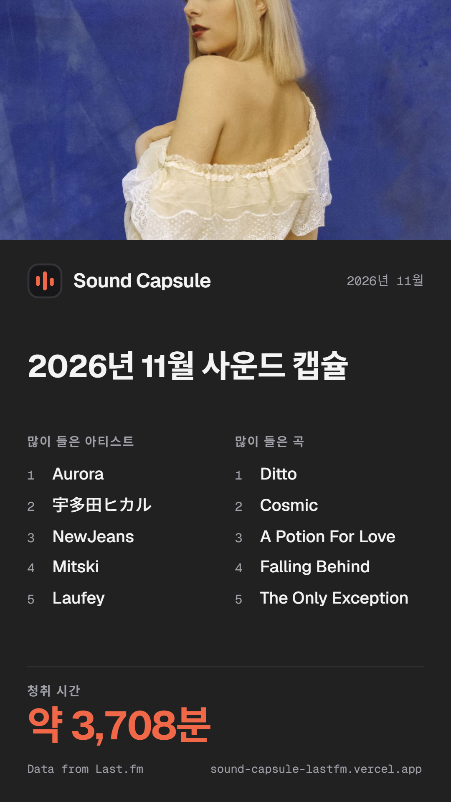

[English](../../README.md) · [Português](README.pt-BR.md) · [Español](README.es.md) · [Français](README.fr.md) · [Deutsch](README.de.md) · [Italiano](README.it.md) · [日本語](README.ja.md) · **한국어** · [简体中文](README.zh-CN.md) · [Русский](README.ru.md) · [Polski](README.pl.md)

# Sound Capsule

Last.fm 스크로블을 다운로드하거나 바로 공유할 수 있는 **세로형 1080×1920 사운드 캡슐**(스토리 형식)로 변환합니다. 집계는 전부 브라우저에서 이루어지며, 로그인도 데이터베이스도 필요 없습니다.

**배포:** <https://sound-capsule-lastfm.vercel.app>



> 데모 데이터가 들어간 예시 카드(Aurora 사진은 Deezer 제공), 사용자 이름 숨김, Ember 테마, 3,708분.

내보낸 PNG에 한국어·일본어·중국어 이름을 렌더링한 예: [CJK 카드](../screenshots/cjk-1080x1920.png).

## 기능

- **홈 화면**: 사용자 입력(사용자 이름 또는 프로필 URL), 기간(지난주, 이번 달, 사용자 지정 기간), 9:16 미리보기, 다운로드/공유 액션을 제공합니다.
- **최대 3개월(달력 기준)의 사용자 지정 기간** — 고정된 90일 기간이 없고, 선택한 날짜도 제한되지 않습니다(Last.fm 가입일부터 오늘까지).
- **9:16 카드**(CSS 432×768, 1080×1920 PNG로 내보내기)이며, 상단 30%는 아티스트 사진, 본문은 단색 `#212121`입니다.
- **5가지 고정 색상 테마**(Ember, Tide, Moss, Plum, Sand)는 카드의 액센트만 변경합니다 — 자유로운 색상 선택기는 없습니다.
- **아티스트 사진**은 3단계로 처리됩니다: Deezer 자동 매칭 → 선택적 로컬 업로드(서버로 전송되지 않음) → 이니셜 기반 캔버스 폴백.
- **번호가 붙은 두 열**(많이 들은 아티스트와 많이 들은 곡, 1–5)로, 말줄임표로 자르고 CJK(일본어, 한국어, 중국어)를 지원합니다.
- **예상 청취 시간**을 테마의 단색으로 강조하고, 계산 방법을 설명하는 툴팁을 제공하며, `Intl`로 서식을 지정합니다.
- **자체 완결형 임베드**: "임베드 코드 복사" 버튼은 PNG를 base64로 넣은 HTML `<a></a>` 블록을 생성합니다 — 업로드도, 저장소도, 호스팅된 이미지 URL도 필요 없습니다(~0.5–0.8 MB). 원시 HTML이 허용되는 곳에서 동작합니다.
- **링크 미리보기**: 사이트 URL을 WhatsApp, Discord, Twitter/X, Telegram 등에 붙여 넣으면 현지화된 제목과 설명, 브랜드가 적용된 1200×630 Open Graph 이미지가 표시됩니다.
- **실제 페이지 진행률**("12 / 40 페이지"), 미리보기 스켈레톤, `AbortController`를 통한 취소를 제공합니다.
- **i18n**: `pt`, `en`, `es`, `fr`, `de`, `it`, `ja`, `ko`, `zh`, `ru`, `pl`을 지원하며, `Accept-Language` 감지, 접두사가 붙은 경로, `Intl`로 서식이 지정된 텍스트/날짜/숫자, 사용자 지정 접근성 언어 드롭다운을 갖추고 있습니다.
- **카드 크레딧**("Data from Last.fm", 프로필 링크, 사이트 URL)이 있으며, 카드에서 사용자 이름을 숨기는 옵션도 있습니다.
- **`<canvas>` 배경**: 마우스에 반응하는 은은한 물결 선이 표시되고, 탭이 숨겨지면 일시 중지되며, `prefers-reduced-motion`에서 꺼집니다.
- **접근성**: 키보드 탐색, 레이블, `role="progressbar"`, 알림, AA 명도 대비, 모션 감소 설정 준수.
- **관측성**: 쿠키를 사용하지 않는 Vercel Web Analytics와 Speed Insights로 방문 수와 Core Web Vitals를 추적합니다.

## 영속성: 언어와 테마만

| 데이터 | 저장 위치 | 세부 정보 |
| --- | --- | --- |
| 언어 | `NEXT_LOCALE` 쿠키 | `pt`, `en`, …만 |
| 카드 색상 | `localStorage`(`sound-capsule:theme`) | 액센트 ID만 |
| 사용자 이름, 날짜, API 결과, 업로드한 사진 | **메모리** | F5에서 사라짐 |

언어를 전환해도 메모리의 사용자 이름과 카드는 유지되지만(Last.fm에 새 요청 없음), 새로고침하면 해당 데이터가 지워집니다. 스크로블, 기록, 사진 데이터는 전혀 저장되지 않습니다.

## 스택

| 계층 | 선택 |
| --- | --- |
| 프레임워크 | Next.js 15(App Router) + TypeScript |
| 스타일링 | Tailwind CSS 4 |
| i18n | `next-intl` 4 |
| 이미지 내보내기 | `html-to-image`(클라이언트 사이드) |
| 테스트 | Vitest |
| 배포 | Vercel(serverless, 정적 + route handlers) |

## 동작 방식

```text
브라우저
  ├─ 사용자/기간 검증(최대 3개월, 달력 기준)
  ├─ /api/lastfm  ──────────►  Last.fm API(키는 서버에서 주입)
  │     └─ user.getInfo, user.getRecentTracks, track.getInfo
  ├─ 모든 스크로블 페이지를 순회(동시성 3 + 150 ms 페이서)
  ├─ 메모리에서 집계: 많이 들은 아티스트, 많이 들은 곡, 청취 시간
  ├─ /api/artist-image ─────►  Deezer 검색(최적 정규화 매칭)
  ├─ /api/image-proxy  ─────►  Deezer CDN(허용 목록 *.dzcdn.net)
  ├─ 선택적 사용자 사진 ────►  로컬 캔버스(브라우저 외부로 나가지 않음)
  └─ DOM에 카드를 렌더링하고 1080×1920 PNG로 내보내기
```

앱은 페이지 로드 시 데이터를 가져오지 않으며, 사용자가 "캡슐 만들기"를 클릭할 때만 가져옵니다. 공개 응답은 `Vercel-CDN-Cache-Control`을 통한 CDN 캐싱을 사용하고, 캐시 적중 시 함수가 호출되지 않습니다.

## 로컬 실행

### 요구 사항

- Node.js **20.9+**
- pnpm **9+**(저장소는 pnpm 11로 개발되었습니다)

### 1. Last.fm API 키 받기

1. <https://www.last.fm/api/account/create>에 접속합니다.
2. 앱 이름(예: *Sound Capsule*), URL `https://sound-capsule-lastfm.vercel.app`, 설명을 입력합니다.
3. 생성된 **API 키**를 복사합니다(사용자 인증이 없으므로 *shared secret*은 필요하지 않습니다).

### 2. 환경 설정

```bash
cp .env.example .env.local
# .env.local을 편집하고 다음을 입력합니다:
LASTFM_API_KEY=your_key_here
```

이 변수는 **서버 전용**입니다. `NEXT_PUBLIC_` 접두사를 절대 사용해서는 안 됩니다. 클라이언트 번들에도 포함되지 않습니다.

### 3. 설치 및 실행

```bash
pnpm install
pnpm dev
```

<http://localhost:3000>을 엽니다 — 미들웨어가 `Accept-Language`(또는 `NEXT_LOCALE` 쿠키)에서 감지한 로케일로 리디렉션합니다.

### 스크립트

| 명령 | 설명 |
| --- | --- |
| `pnpm dev` | 개발 서버 |
| `pnpm build` | 프로덕션 빌드 |
| `pnpm start` | 프로덕션 빌드 제공 |
| `pnpm test` | 단위 테스트(Vitest) |
| `pnpm test:watch` | 워치 모드 테스트 |
| `pnpm typecheck` | `tsc --noEmit`으로 타입 검사 |

## Vercel에 배포

현재 배포는 <https://sound-capsule-lastfm.vercel.app>에 있습니다.

1. 프로젝트를 GitHub/GitLab/Bitbucket 저장소에 푸시합니다.
2. Vercel에서 **Add New → Project**를 클릭하고 저장소를 가져옵니다.
3. **Next.js** 프리셋이 자동으로 감지됩니다. 다음을 확인합니다:
   - Install Command: `pnpm install`
   - Build Command: `pnpm build`
   - Output: Next.js 기본값
4. **Settings → Environment Variables**에서 Production에 `LASTFM_API_KEY`를 추가합니다(미리보기를 테스트하려면 Preview/Development에도 추가합니다).
5. 배포합니다. 데이터베이스, 마이그레이션, cron 작업, 스토리지 설정이 없습니다.
6. 선택 사항: **Settings → Domains**에서 사용자 지정 도메인을 설정합니다.

이 프로젝트는 **Hobby** 플랜(개인/비상업용)에 맞게 설계되었습니다. 일반적인 캡슐 하나에서 약 60–176회의 함수 호출이 발생하며, CDN 캐싱으로 안정적인 호출의 반복을 피합니다. 사진 업로드는 100% 로컬이므로 함수도, 대역폭도, Vercel의 4.5 MB 본문 제한도 소비하지 않습니다.

프로덕션 참고 사항:

- 라우트 핸들러는 업스트림에 `AbortSignal.timeout(10s)`를 사용합니다. 각 호출은 짧고 독립적입니다.
- `track.getInfo`와 이미지는 CDN에 24시간 유지되고, 사용자 데이터는 1–5분 유지됩니다. 오류는 절대 캐시되지 않습니다.
- 이미지 프록시는 스트리밍 모드로 응답하므로 4.5 MB 비스트리밍 응답 제한에 걸리지 않습니다.
- CJK 폰트는 빌드 시 `next/font`가 자체 호스팅합니다. 환경에서 Google Fonts에 접근할 수 있어야 합니다.

## 구조

```text
app/
  [locale]/
    layout.tsx            # 루트 레이아웃: 폰트, i18n 프로바이더, 메타데이터/SEO
    page.tsx              # 홈 화면(서버) + CapsuleStudio(클라이언트)
    [...rest]/page.tsx    # 알 수 없는 경로 → notFound()
  api/
    lastfm/route.ts       # 메서드와 파라미터 허용 목록이 있는 프록시
    artist-image/route.ts # Deezer 검색 + 정규화 매칭
    image-proxy/route.ts  # 이미지 프록시(허용 목록 + 스트리밍)
  robots.ts               # robots.txt(/api/ 차단, 사이트맵 지정)
  sitemap.ts              # 11개 라우트 사이트맵(alternates 포함)
  globals.css             # 디자인 토큰(Tailwind 4)
  icon.svg                # 브랜드/파비콘
components/
  CapsuleStudio.tsx       # 폼, 테마, 업로드, 진행률, 내보내기/공유/임베드
  CapsuleCard.tsx         # 크레딧과 테마가 있는 432×768 카드
  CardHero.tsx            # 아티스트 사진/업로드 또는 캔버스 폴백
  BackgroundCanvas.tsx    # 배경 물결(마우스, 모션 감소, 숨김)
  SiteHeader.tsx / SiteFooter.tsx / BrandMark.tsx
  LocaleSwitcher.tsx      # 사용자 지정 접근성 언어 드롭다운
i18n/                     # next-intl 라우팅/요청/내비게이션
lib/
  lastfmClient.ts         # 페이지네이션, 동시성, 페이서, 재시도/백오프, 중단
  aggregate.ts            # 집계와 분 단위 추정(테스트됨)
  periods.ts              # 기간, 3개월 제한, Intl
  artistMatch.ts          # 정규화된 Deezer 매칭
  artistImage.ts          # 히어로 사진 해석/프리로드
  localPhoto.ts           # 업로드 사진의 로컬 검증/리사이즈
  cardThemes.ts           # 고정 액센트와 ID만 영속화
  studioSession.ts        # 언어 전환용 인메모리 상태
  site.ts / httpCache.ts  # URL/User-Agent와 캐시 헤더
  exportCard.ts           # 폰트 임베드 + html-to-image → 1080×1920 PNG
  initials.ts / locales.ts
public/
  og/<locale>.png          # Open Graph/Twitter 미리보기 1200×630
  llms.txt                # 에이전트/LLM용 프로젝트 요약
messages/                 # pt, en, es, fr, de, it, ja, ko, zh, ru, pl
tests/                    # Vitest
../screenshots/         # 참고 스크린샷
```

## 링크 미리보기, SEO, 검색 노출

- 11개 라우트 모두에 `metadataBase` + Open Graph/Twitter Card를 설정하고 제목과 설명을 현지화했습니다.
- `og:image`와 `twitter:image`에는 `public/og/<locale>.png` 이미지(1200×630)를 사용합니다. 이는 링크를 WhatsApp, Discord, Telegram, Twitter/X 등에 붙여 넣을 때 표시되는 미리보기입니다.
- `/robots.txt`는 `app/robots.ts`가 생성하며, 사이트를 허용하고 `/api/`를 차단하며 사이트맵을 가리킵니다.
- `/sitemap.xml`은 `app/sitemap.ts`가 생성하며, 11개 라우트와 `hreflang` alternates를 포함합니다.
- `/llms.txt`에는 AI 에이전트를 위한 제품, 데이터 소스, 개인정보 처리방침의 사실 기반 요약이 담겨 있습니다.

## 기술적 결정

### `user.getTopTracks` 대신 `user.getRecentTracks`를 쓰는 이유는?

`getTopTracks`/`getTopArtists`는 고정된 기간(`7day`, `1month` 등)만 허용하며, Last.fm의 "월"은 현재 달력 월이 아닙니다. 앱은 `from`/`to`(unix)로 `user.getRecentTracks`를 페이지네이션하고 로컬에서 집계하여, **"이번 달"**이 방문자의 시간대에서 1일부터 현재까지와 정확히 일치하도록 보장합니다.

- 페이지당 `limit=200`; 첫 페이지에서 `totalPages`를 확인합니다.
- 나머지 페이지는 **동시성 3**으로 병렬 실행되며, Last.fm 사용 지침을 지키기 위해 **호출 사이에 150 ms 페이서**를 둡니다.
- 오류 29(요청 제한), 5xx, 네트워크 장애에는 **지수 백오프**로 재시도합니다.
- "현재 재생 중" 트랙(`@attr.nowplaying`)은 무시합니다.
- **취소** 버튼은 진행 중인 모든 요청을 중단합니다(`AbortController`).

### 청취 시간

Last.fm은 청취 시간을 제공하지 않습니다. 추정 방법은 다음과 같습니다.

1. **가장 많이 재생한 50곡**의 실제 길이(`track.getInfo` → `duration`, 밀리초)를 가져옵니다(동시성 3).
2. 길이가 없거나 0인 곡, 상위 50곡 밖의 곡은 **3.5분(210초)**으로 처리합니다.
3. `minutes = round(Σ duration × scrobbles / 60,000)`.

UI는 값을 근사치로 표시하고(`약 66분`), 툴팁에서 계산 방법을 설명합니다. 폴백과 상위 50곡 제한은 `lib/periods.ts`에서 설정할 수 있습니다.

### 아티스트 사진

Last.fm은 더 이상 실제 사진을 반환하지 않습니다(플레이스홀더). 앱은 Deezer를 호출해 정규화 유사도가 가장 높은 결과를 선택하고, 중복된 이름 중에서는 **가장 인기 있는 정확 일치**를 우선합니다 — 그렇지 않으면 TWICE 대신 무명의 "Twice"가 표시될 수 있습니다. 사용자는 로컬 사진(JPEG/PNG/WebP, 최대 10 MB)을 업로드할 수도 있으며, 캔버스에서 리사이즈되어 브라우저 메모리에서만 사용됩니다. 아무것도 찾지 못하면 카드는 절차적 캔버스 폴백을 사용합니다.

### 테마

`lib/cardThemes.ts`의 5가지 고정 액센트로, 카드의 액센트 색상(브랜드와 청취 시간)만 바뀝니다. 테마 데이터로 저장되는 것은 선택한 ID뿐이며, 이는 `localStorage`에 보관됩니다. 사이트 자체는 중립적으로 유지됩니다.

### 언어 간 상태

`CapsuleStudio`는 현지화되지 않은 데이터를 인메모리 저장소(`lib/studioSession.ts`)에 보관합니다. 언어를 전환하면 컴포넌트가 다시 마운트되고, 저장소에서 하이드레이션한 뒤 새 로케일로 텍스트만 다시 계산합니다 — **Last.fm 요청은 0회**입니다. 언어 자체는 `NEXT_LOCALE` 쿠키에 저장됩니다.

### 1080×1920 내보내기

`html-to-image`는 카드(432×768)를 `pixelRatio: 2.5`로 렌더링합니다. 내보내기 전에:

- `document.fonts.ready` + 두 번의 레이아웃 프레임;
- 카드의 모든 `` 디코딩;
- 맞춤 폰트 임베드는 **`unicode-range`가 카드의 문자와 교차하는 서브셋만** 포함하여 불필요한 CJK 슬라이스 수 MB를 내려받지 않습니다.

최종 PNG는 정확히 **1080×1920**입니다(사용자가 업로드한 사진을 포함해 브라우저에서 검증했습니다).

### 디자인

중립적인 팔레트, 카드마다 단일 단색 액센트, 네온/그라디언트/글래스모피즘은 사용하지 않습니다:

| 토큰 | 값 |
| --- | --- |
| 배경 | `#0f0f10` |
| 폼 표면 | `#171719` |
| 입력 필드 | `#111113` |
| 카드 본문 | `#212121` |
| 액센트 | Ember `#F06848`, Tide `#5B9DFF`, Moss `#7ED08A`, Plum `#C084FC`, Sand `#E7C27A` |
| 텍스트 | `#f4f4f5` / 흐린 색 `#a1a1aa` |

타이포그래피: Geist(산세리프) + Geist Mono(숫자/세부 정보) + CJK용 Noto Sans JP/KR/SC.

## 개인정보, 보안 및 이용 약관

- `LASTFM_API_KEY`는 서버에만 존재하며, 클라이언트는 절대 받지 못합니다.
- `/api/lastfm`은 `user.getInfo`, `user.getRecentTracks`, `track.getInfo`만 허용하고, 클라이언트가 보낸 `api_key`/`format`을 거부하며, 정수(범위와 제한), 사용자 이름, 제어 문자를 검증합니다.
- `/api/image-proxy`는 `*.dzcdn.net`의 `https` URL만 허용하고, 리디렉션 후 호스트를 다시 검증하며, `Content-Type: image/*`를 요구하고, 스트리밍 모드로 응답합니다.
- 앱은 Last.fm/Deezer에 식별 가능한 User-Agent를 전송합니다.
- [Last.fm TOS](https://www.last.fm/api/tos)에 따른 출처 표시: 푸터의 "powered by Last.fm" 링크와 내보낸 카드의 "Data from Last.fm", 프로필, 사이트 URL 크레딧.
- **저장되는 데이터만**: 언어(쿠키)와 카드 액센트(`localStorage`). 데이터베이스, 스크로블 저장, 로그인, 세션 쿠키는 없습니다.
- 사용자 기록에서 앱 로그에 기록되는 것은 없습니다. 이 프로젝트는 개인적이며 비상업적입니다.

### 관측성

- Vercel Web Analytics(`@vercel/analytics`)와 Speed Insights(`@vercel/speed-insights`)가 로케일 레이아웃에 설치되어 있습니다.
- 둘 다 쿠키를 사용하지 않으며 사용자 이름, 카드 데이터, 스크로블 데이터를 수집하지 않습니다.
- Hobby에서는 Web Analytics가 월 50,000개 이벤트, Speed Insights가 최근 30일간 10,000개 이벤트를 포함합니다. 둘 다 해당 한도 내에서는 무료이며, 초과분은 청구 대신 수집이 일시 중지됩니다.

## i18n

- 로케일: `pt`(기본값, pt-BR 콘텐츠), `en`, `es`, `fr`, `de`, `it`, `ja`, `ko`, `zh`(중국어 간체), `ru`, `pl`.
- 미들웨어의 `Accept-Language` 감지(`NEXT_LOCALE` 쿠키가 우선); 헤더에서 수동으로 전환하면 경로와 메모리의 카드가 유지됩니다. 선택기는 네이티브 `<select>`가 아닌 사용자 지정 드롭다운입니다.
- 날짜와 숫자는 올바른 지역 로케일(`pt-BR`, `en-US`, `es-ES`, `fr-FR`, `de-DE`, `it-IT`, `ja-JP`, `ko-KR`, `zh-CN`, `ru-RU`, `pl-PL`)로 `Intl`을 사용합니다.
- 카드 텍스트는 인터페이스와 함께 번역되며, 내보낸 이미지는 이미 활성 언어를 사용합니다.
- 폰트: Geist는 라틴/라틴 확장/키릴 문자를 불러오고, Noto Sans JP/KR/SC는 카드의 CJK 문자를 처리합니다.

## 테스트

```bash
pnpm test        # 108개 단위 테스트
pnpm typecheck
pnpm build
```

현재 커버리지:

- 사용자 필드에 붙여 넣은 프로필 URL 정규화;
- 스크로블 집계, 동점 처리, CJK, 청취 시간 계산;
- 기간 간격, **달력 기준 3개월** 제한, 2월/31일인 달, 가입일, 미래, `Intl`;
- `fetch`를 모킹한 Last.fm 클라이언트: 페이지네이션, 현재 재생 중, 재시도 29/네트워크, 중단, 상위 50곡 길이, 오류 6/17, 가입일(`unixtime`);
- Deezer 아티스트 매칭(중복 이름 사이의 인기도 동점 처리 포함);
- API 라우트: 허용 목록, 서버 키, User-Agent, 캐시 헤더, 이미지 프록시 스트리밍;
- 테마와 세션 저장소;
- 로컬 업로드 검증(유형/크기).

또한 시뮬레이션한 Last.fm/Deezer로 Chromium에서 흐름을 검증했습니다: 테마, 업로드, 크레딧, 사용자 이름 숨김, 자체 완결형 임베드(클립보드), 새 요청 없는 언어 전환, 사용자 지정 드롭다운(마우스, 키보드, 바깥 클릭), `ko`/`ru`/`zh`/`pl` 라우트, 모바일에서 미리보기로 자동 스크롤, 쿠키/localStorage만 허용, F5, 달력 기준 3개월 검증, **1080×1920** 내보내기. 실제 흐름은 활성 프로필로 Last.fm/Deezer API에 대해서도 실행했습니다.

## 알려진 제한 사항

- **최대 3개월(달력 기준) 기간**: Last.fm의 합리적인 사용과 Hobby 플랜에 맞도록 설계되었습니다. 연간 결산에는 다른 아키텍처/제한이 필요합니다.
- **청취 시간은 추정치**: `track.getInfo` 길이와 210초 폴백에 의존하므로 라이브 트랙/리믹스에서는 차이가 날 수 있습니다.
- **사진은 Deezer에서 가져옴**: 이름 매칭은 같은 이름의 아티스트에서 실패하거나 아무것도 찾지 못할 수 있습니다(그 경우 캔버스 폴백 사용). 다른 문자 체계의 이름(예: 南翔子, "Shoko Minami"로 색인됨)은 일치하지 않을 수 있습니다. 로컬 업로드가 이런 경우를 처리합니다.
- **업로드는 저장되지 않음**: 사진은 메모리에만 존재하며 결과와 사용자 이름처럼 F5에서 사라집니다.
- **비공개 프로필**("hide recent listening")은 오류 17을 반환합니다. 앱이 활성화 방법을 설명합니다.
- **클라이언트 사이드 내보내기**는 브라우저에 의존합니다(Chromium에서 테스트). 메모리가 적은 오래된 기기/Safari에서는 PNG 생성이 실패할 수 있으며, 그 경우 오류 메시지가 표시됩니다.
- **Web Share API**는 모든 브라우저에서 지원되는 것은 아닙니다. 사용할 수 없는 경우 앱이 PNG를 다운로드합니다.
- 카드는 사진과 폰트가 로드된 후에만 렌더링되며, 미리보기는 로드를 기다린 후 PNG를 활성화합니다.

## 문제 해결

| 증상 | 가능한 원인 / 해결책 |
| --- | --- |
| "서버에 Last.fm API 키가 없습니다" | `.env.local`(또는 Vercel)에 `LASTFM_API_KEY`가 없습니다. 서버를 다시 시작하십시오. |
| "Last.fm에서 사용자를 찾을 수 없습니다" | 유효하지 않거나 존재하지 않는 사용자 이름입니다. `last.fm/user/<name>`에서 확인하십시오. |
| "스크로블이 비공개로 설정되어 있습니다" | Last.fm 개인정보 설정에서 "Show recent listening"을 켜십시오. |
| "이 기간에 스크로블이 없습니다" | 선택한 기간에 공개 기록이 없습니다. |
| "Last.fm 요청 한도를 초과했습니다" | 잠시 기다린 후 다시 시도하십시오. 앱은 이미 페이서와 백오프를 적용합니다. |
| 사진 없는 미리보기 | Deezer가 아티스트를 찾지 못했습니다. 사진을 업로드하거나 기하학적 폴백을 사용하십시오. |
| "JPEG, PNG, WebP 파일을 사용해 주세요" / "이미지는 최대 10MB까지 업로드할 수 있습니다" | 로컬 사진의 형식/크기가 허용 범위를 벗어났습니다. |
| CJK 폰트가 표시되지 않음 | 빌드가 Google Fonts에서 Noto Sans JP/KR/SC를 다운로드할 수 있었는지 확인하십시오. |
| `prerender /404`에서 빌드 실패 | `node_modules`가 손상된 증상입니다. `node_modules`를 삭제하고 `pnpm install`을 다시 실행하십시오. |

## 면책 고지

Sound Capsule은 독립적인 프로젝트이며 Last.fm이나 어떤 스트리밍 서비스와도 제휴하지 않습니다. 음악 데이터는 공개되어 있으며 Last.fm API에서 제공됩니다. 아티스트 사진은 Deezer 또는 사용자로부터 제공됩니다. Vercel Hobby 플랜의 사용은 개인적이고 비상업적입니다.

## 제작

제작: [Ranieeery](https://github.com/Ranieeery).

