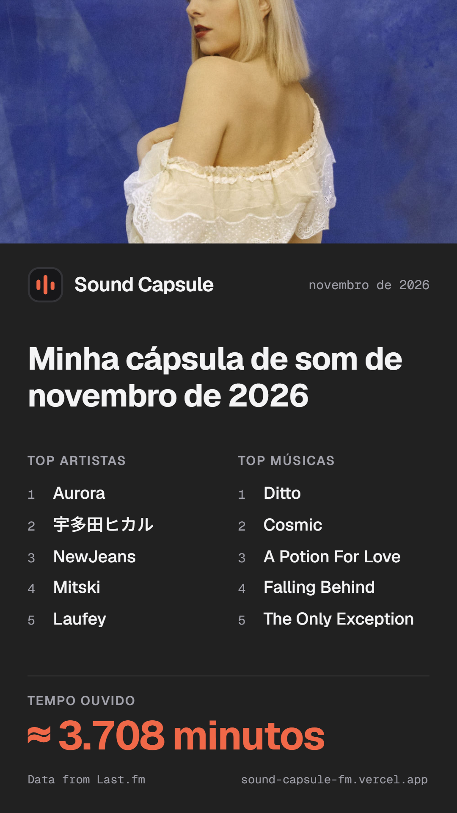

[English](../../README.md) · **Português** · [Español](README.es.md) · [Français](README.fr.md) · [Deutsch](README.de.md) · [Italiano](README.it.md) · [日本語](README.ja.md) · [한국어](README.ko.md) · [简体中文](README.zh-CN.md) · [Русский](README.ru.md) · [Polski](README.pl.md)

# Sound Capsule for Last.fm

Transforme seus scrobbles do Last.fm em uma **cápsula de som vertical 1080×1920** (formato story) pronta para baixar ou compartilhar. A agregação acontece inteiramente no navegador, sem login e sem banco de dados.

**Deploy:** <https://sound-capsule-fm.vercel.app>



> Card de exemplo com dados fictícios (foto da Aurora via Deezer), username oculto, tema Ember e 3.708 minutos.


## Recursos

- **Tela inicial** com input de usuário (aceita o username ou a URL do perfil), período (última semana, mês atual ou intervalo personalizado), prévia 9:16 e ações de download/compartilhamento.
- **Período personalizado com duração máxima de 3 meses de calendário** — sem janela fixa de 90 dias e sem restringir as datas escolhidas (desde o registro no Last.fm até hoje).
- **Card 9:16** (432×768 CSS, exportado a 1080×1920 PNG) com topo de 30% em foto do artista e corpo sólido `#212121`.
- **Cinco temas de cor fixos** (Ember, Tide, Moss, Plum, Sand) que mudam só o accent do card — sem color picker livre.
- **Foto do artista** em três camadas: match automático no Deezer → upload local opcional (nunca enviado ao servidor) → fallback canvas com iniciais.
- **Duas colunas numeradas** (Top artistas e Top músicas, 1–5) com truncamento por reticências e suporte a CJK (japonês, coreano e chinês).
- **Minutagem estimada** com destaque sólido na cor do tema, tooltip explicando o cálculo e formatação via `Intl`.
- **Embed autocontido**: o botão “Copiar embed” gera um bloco HTML `<a></a>` com a PNG em base64 — sem upload, sem storage e sem depender de URL de imagem hospedada (~0,5–0,8 MB). Funciona onde HTML bruto é permitido.
- **Preview de link**: ao colar a URL do site no WhatsApp, Discord, Twitter/X, Telegram etc., aparecem título, descrição localizados e uma imagem Open Graph 1200×630 da marca.
- **Progresso real** de paginação ("Página 12 de 40"), skeleton na prévia e cancelamento com `AbortController`.
- **i18n** em `pt`, `en`, `es`, `fr`, `de`, `it`, `ja`, `ko`, `zh`, `ru` e `pl`, com detecção por `Accept-Language`, rotas prefixadas, textos/datas/números formatados com `Intl` e dropdown de idioma customizado e acessível.
- **Créditos no card** (“Data from Last.fm”, link do perfil e URL do site), com opção de ocultar o username do card.
- **Fundo em `<canvas>`** com linhas de onda discretas que reagem ao mouse, pausam com a aba oculta e desligam com `prefers-reduced-motion`.
- **Acessível**: navegação por teclado, labels, `role="progressbar"`, alerts, contraste AA e respeito a movimento reduzido.
- **Observabilidade**: Vercel Web Analytics e Speed Insights, sem cookies, para acompanhar visitas e Core Web Vitals.

## Persistência: só idioma e tema

| Dado | Onde fica | Detalhe |
| --- | --- | --- |
| Idioma | cookie `NEXT_LOCALE` | apenas `pt`, `en`, … |
| Cor do card | `localStorage` (`sound-capsule:theme`) | apenas o id do accent |
| Username, datas, resultado da API, foto enviada | **memória** | somem no F5 |

A troca de idioma preserva username e card em memória (sem novas requisições ao Last.fm), mas um reload limpa esses dados. Nenhum dado de scrobbles, histórico ou foto é persistido.

## Stack

| Camada | Escolha |
| --- | --- |
| Framework | Next.js 15 (App Router) + TypeScript |
| Estilo | Tailwind CSS 4 |
| i18n | `next-intl` 4 |
| Export da imagem | `html-to-image` (client-side) |
| Testes | Vitest |
| Deploy | Vercel (serverless, estático + route handlers) |

## Como funciona

```text
Navegador
  ├─ valida usuário/período (máx. 3 meses de calendário)
  ├─ /api/lastfm  ──────────►  Last.fm API (key injetada no servidor)
  │     └─ user.getInfo, user.getRecentTracks, track.getInfo
  ├─ pagina TODAS as páginas de scrobbles (concorrência 3 + pacer de 150 ms)
  ├─ agrega em memória: top artistas, top músicas, minutagem
  ├─ /api/artist-image ─────►  Deezer search (melhor match normalizado)
  ├─ /api/image-proxy  ─────►  CDN do Deezer (whitelist *.dzcdn.net)
  ├─ foto opcional do usuário ─►  canvas local (nunca sai do navegador)
  └─ renderiza o card no DOM e exporta PNG 1080×1920
```

O app não busca dados no carregamento da página; só quando o usuário clica em Gerar. As respostas públicas usam cache de CDN com `Vercel-CDN-Cache-Control`; cache hit não invoca a function.

## Rodando localmente

### Requisitos

- Node.js **20.9+**
- pnpm **9+** (o repositório foi desenvolvido com pnpm 11)

### 1. Obtenha uma API key do Last.fm

1. Acesse <https://www.last.fm/api/account/create>.
2. Preencha o nome do app (ex.: *Sound Capsule*), a URL `https://sound-capsule-fm.vercel.app` e a descrição.
3. Copie a **API key** gerada (não é necessário o *shared secret*, pois não há autenticação de usuário).

### 2. Configure o ambiente

```bash
cp .env.example .env.local
# edite .env.local e preencha:
LASTFM_API_KEY=sua_chave_aqui
```

A variável é **somente do servidor**. Nunca use o prefixo `NEXT_PUBLIC_` e ela não vai para o bundle do cliente.

### 3. Instale e rode

```bash
pnpm install
pnpm dev
```

Abra <http://localhost:3000> — o middleware redireciona para o locale detectado pelo `Accept-Language` (ou pelo cookie `NEXT_LOCALE`).

### Scripts

| Comando | Descrição |
| --- | --- |
| `pnpm dev` | servidor de desenvolvimento |
| `pnpm build` | build de produção |
| `pnpm start` | serve o build de produção |
| `pnpm test` | testes unitários (Vitest) |
| `pnpm test:watch` | testes em watch mode |
| `pnpm typecheck` | checagem de tipos com `tsc --noEmit` |

## Deploy na Vercel

O deploy atual está em <https://sound-capsule-fm.vercel.app>.

1. Suba o projeto para um repositório no GitHub/GitLab/Bitbucket.
2. Na Vercel, clique em **Add New → Project** e importe o repositório.
3. O preset **Next.js** é detectado automaticamente. Confirme:
   - Install Command: `pnpm install`
   - Build Command: `pnpm build`
   - Output: padrão do Next.js
4. Em **Settings → Environment Variables**, adicione `LASTFM_API_KEY` em Production (e, se quiser testar previews, também Preview/Development).
5. Faça o deploy. Não há banco de dados, migrations, cron jobs ou storage para configurar.
6. Opcional: configure domínio customizado em **Settings → Domains**.

O projeto foi pensado para o plano **Hobby** (pessoal/não comercial): cada cápsula típica faz ~60–176 invocations de function, e o cache de CDN evita repetir chamadas estáveis. O upload de foto é 100% local, então não consome função, banda nem o limite de 4,5 MB de corpo da Vercel.

Observações de produção:

- Os route handlers usam `AbortSignal.timeout(10s)` para o upstream; cada chamada é curta e independente.
- `track.getInfo` e imagens ficam 24 h no CDN; dados de usuário ficam 1–5 min. Erros nunca são cacheados.
- O proxy de imagem responde em streaming para não esbarrar no limite de resposta não-streamed de 4,5 MB.
- As fontes CJK são self-hosted pelo `next/font` durante o build; o ambiente precisa acessar o Google Fonts.

## Estrutura

```text
app/
  [locale]/
    layout.tsx            # layout raiz: fontes, provider i18n, metadata/SEO
    page.tsx              # tela inicial (server) + CapsuleStudio (client)
    [...rest]/page.tsx    # rotas desconhecidas → notFound()
  api/
    lastfm/route.ts       # proxy com whitelist de métodos e params
    artist-image/route.ts # busca no Deezer + matching normalizado
    image-proxy/route.ts  # proxy de imagem (whitelist + streaming)
  robots.ts               # robots.txt (bloqueia /api/, aponta o sitemap)
  sitemap.ts              # sitemap das 11 rotas com alternates
  globals.css             # tokens de design (Tailwind 4)
  icon.svg                # marca/favicon
components/
  CapsuleStudio.tsx       # formulário, tema, upload, progresso, export/share/embed
  CapsuleCard.tsx         # card 432×768 com créditos e tema
  CardHero.tsx            # foto do artista/upload ou fallback canvas
  BackgroundCanvas.tsx    # ondas de fundo (mouse, reduced motion, hidden)
  SiteHeader.tsx / SiteFooter.tsx / BrandMark.tsx
  LocaleSwitcher.tsx      # dropdown customizado e acessível de idioma
i18n/                     # routing/request/navigation do next-intl
lib/
  lastfmClient.ts         # paginação, concorrência, pacer, retry/backoff, abort
  aggregate.ts            # agregação e estimativa de minutos (testado)
  periods.ts              # intervalos, limite de 3 meses, Intl
  artistMatch.ts          # matching normalizado do Deezer
  artistImage.ts          # resolução/pré-carregamento da foto hero
  localPhoto.ts           # validação/resize local da foto enviada
  cardThemes.ts           # accents fixos e persistência só do id
  studioSession.ts        # estado em memória para trocar de idioma
  site.ts / httpCache.ts  # URL/User-Agent e headers de cache
  exportCard.ts           # embed de fontes + html-to-image → PNG 1080×1920
  initials.ts / locales.ts
public/
  og/<locale>.png          # preview Open Graph/Twitter 1200×630
  llms.txt                # resumo do projeto para agentes/LLMs
messages/                 # pt, en, es, fr, de, it, ja, ko, zh, ru, pl
tests/                    # Vitest
../screenshots/         # capturas de referência
```

## Preview de link, SEO e descoberta

- `metadataBase` + Open Graph/Twitter Card em todas as 11 rotas, com título e descrição localizados.
- Imagem `public/og/<locale>.png` (1200×630) usada em `og:image` e `twitter:image`; é o preview exibido ao colar o link no WhatsApp, Discord, Telegram, Twitter/X etc.
- `/robots.txt` gerado por `app/robots.ts`, liberando o site, bloqueando `/api/` e apontando para o sitemap.
- `/sitemap.xml` gerado por `app/sitemap.ts`, com as 11 rotas e `hreflang` alternates.
- `/llms.txt` com um resumo factual do produto, fontes de dados e política de privacidade para agentes de IA.

## Decisões técnicas

### Por que `user.getRecentTracks` em vez de `user.getTopTracks`?

`getTopTracks`/`getTopArtists` só aceitam janelas fixas (`7day`, `1month`…), e o "mês" do Last.fm não é o mês corrente. O app pagina `user.getRecentTracks` com `from`/`to` (unix) e agrega localmente, garantindo que **"mês atual"** seja exatamente do dia 1 até agora no fuso do visitante.

- `limit=200` por página; a primeira página descobre `totalPages`.
- As demais páginas rodam em paralelo com **concorrência 3**, com um pacer de **150 ms entre chamadas** para não estourar a orientação de uso do Last.fm.
- Retry com **backoff exponencial** para erro 29 (rate limit), 5xx e falhas de rede.
- A faixa "now playing" (`@attr.nowplaying`) é ignorada.
- O botão **Cancelar** aborta todas as requisições em andamento (`AbortController`).

### Minutagem

O Last.fm não expõe tempo ouvido. A estimativa:

1. Busca a duração real (`track.getInfo` → `duration` em ms) para as **50 faixas mais tocadas** (concorrência 3).
2. Faixas sem duração, com duração 0 ou fora do top 50 usam **3,5 min (210 s)**.
3. `minutos = arredondar(Σ duração × scrobbles / 60.000)`.

A UI mostra o valor como aproximado (`≈ 66 minutos`) e o tooltip explica o cálculo. O fallback e o limite do top 50 são configuráveis em `lib/periods.ts`.

### Foto do artista

O Last.fm não retorna mais fotos reais (placeholder). O app chama o Deezer, escolhe o resultado com melhor similaridade normalizada e prioriza o **match exato mais popular** em nomes repetidos — sem isso, um "Twice" obscuro podia aparecer no lugar do TWICE. O usuário também pode enviar uma foto local (JPEG/PNG/WebP, até 10 MB): ela é redimensionada no canvas e usada só na memória do navegador. Se nada for encontrado, o card usa o fallback procedural em canvas.

### Temas

Cinco accents fixos em `lib/cardThemes.ts`; só a cor de destaque do card muda (marca e minutagem). O id escolhido é o único dado de tema salvo, em `localStorage`. O site continua neutro.

### Estado entre idiomas

O `CapsuleStudio` mantém os dados não localizados em um store em memória (`lib/studioSession.ts`). Ao trocar de idioma o componente remonta, hidrata do store e apenas recalcula os textos com o novo locale — **zero requisições ao Last.fm**. O idioma em si é persistido no cookie `NEXT_LOCALE`.

### Export 1080×1920

`html-to-image` renderiza o card (432×768) com `pixelRatio: 2.5`. Antes do export:

- `document.fonts.ready` + dois frames de layout;
- todas as `` do card são decodificadas;
- um embed de fontes sob medida inclui **somente os subsetos cujo `unicode-range` intersecta os caracteres do card**, evitando baixar megabytes de slices CJK desnecessários.

O PNG final é exatamente **1080×1920** (verificado em navegador, inclusive com foto enviada pelo usuário).

### Design

Paleta neutra, uma única cor de destaque sólida por card, sem neon/gradiente/glassmorphism:

| Token | Valor |
| --- | --- |
| Fundo | `#0f0f10` |
| Superfície do formulário | `#171719` |
| Inputs | `#111113` |
| Corpo do card | `#212121` |
| Accents | Ember `#F06848`, Tide `#5B9DFF`, Moss `#7ED08A`, Plum `#C084FC`, Sand `#E7C27A` |
| Texto | `#f4f4f5` / muted `#a1a1aa` |

Tipografia: Geist (sans) + Geist Mono (números/detalhes) + Noto Sans JP/KR/SC para CJK.

## Privacidade, segurança e TOS

- `LASTFM_API_KEY` existe apenas no servidor; o cliente nunca a recebe.
- `/api/lastfm` aceita apenas `user.getInfo`, `user.getRecentTracks` e `track.getInfo`; rejeita `api_key`/`format` enviados pelo cliente, valida inteiros (faixas e limites), username e caracteres de controle.
- `/api/image-proxy` aceita somente URLs `https` em `*.dzcdn.net`, revalida o host após redirects, exige `Content-Type: image/*` e responde em streaming.
- O app envia User-Agent identificável ao Last.fm/Deezer.
- Atribuição conforme a [TOS do Last.fm](https://www.last.fm/api/tos): link “powered by Last.fm” no rodapé e créditos “Data from Last.fm”, perfil e URL do site no card exportado.
- **Único dado persistido**: idioma (cookie) e accent do card (`localStorage`). Não há banco, storage de scrobbles, login nem cookies de sessão.
- Nada do histórico do usuário é registrado em logs do app. O projeto é pessoal e não comercial.
- **Observabilidade**: Vercel Web Analytics (page views) e Speed Insights (Core Web Vitals) instalados no layout. São cookieless e não recebem username, card ou dados de scrobble. No Hobby, os limites são 50.000 eventos/mês (Analytics) e 10.000 eventos/30 dias (Speed Insights); dentro da cota não há cobrança e a coleta pausa em vez de gerar overage.

## i18n

- Locales: `pt` (padrão, conteúdo pt-BR), `en`, `es`, `fr`, `de`, `it`, `ja`, `ko`, `zh` (chinês simplificado), `ru` e `pl`.
- Detecção por `Accept-Language` no middleware (o cookie `NEXT_LOCALE` tem prioridade); troca manual no header preserva a rota e o card em memória. O seletor é um dropdown customizado, não o `<select>` nativo.
- Datas e números usam `Intl` com o locale regional correto (`pt-BR`, `en-US`, `es-ES`, `fr-FR`, `de-DE`, `it-IT`, `ja-JP`, `ko-KR`, `zh-CN`, `ru-RU`, `pl-PL`).
- O texto do card é traduzido junto com a interface; a imagem exportada já usa o idioma ativo.
- Fontes: Geist carrega latin/latin-ext/cirílico; Noto Sans JP/KR/SC cobre os caracteres CJK no card.

## Testes

```bash
pnpm test        # 108 testes unitários
pnpm typecheck
pnpm build
```

Cobertura atual:

- normalização de URLs de perfil coladas no campo de usuário;
- agregação de scrobbles, desempates, CJK e cálculo de minutagem;
- intervalos de período, limite de **3 meses de calendário**, fevereiro/meses de 31 dias, registro, futuro e `Intl`;
- cliente Last.fm com `fetch` mockado: paginação, now playing, retry 29/rede, abort, top 50 durações, erros 6/17, data de registro (`unixtime`);
- matching de artistas no Deezer (incluindo desempate por popularidade em nomes repetidos);
- rotas de API: whitelist, key do servidor, User-Agent, cache headers, streaming do proxy de imagem;
- temas e store de sessão;
- validação do upload local (tipo/tamanho).

Além disso, o fluxo foi verificado em Chromium com Last.fm/Deezer simulados: tema, upload, créditos, username oculto, embed autocontido (clipboard), troca de idioma sem novas requisições, dropdown customizado (mouse, teclado e clique fora), rotas `ko`/`ru`/`zh`/`pl`, scroll automático para a prévia no mobile, apenas cookie/localStorage permitidos, F5, validação de 3 meses e export **1080×1920**. O fluxo real também foi executado contra a API do Last.fm/Deezer com um perfil ativo.

## Limitações conhecidas

- **Período máximo de 3 meses de calendário**: pensado para caber no uso razoável do Last.fm e no plano Hobby. Recaps anuais exigiriam outra arquitetura/limite.
- **Minutagem é estimativa**: depende de durações do `track.getInfo` e do fallback de 210 s; faixas ao vivo/remixes podem divergir.
- **Fotos vêm do Deezer**: matching por nome pode errar em artistas homônimos ou não encontrar nada (usa fallback canvas). Nomes em outro alfabeto (ex.: 南翔子, indexado como "Shoko Minami") podem não ter correspondência. O upload local cobre esses casos.
- **Upload não é persistido**: a foto existe só na memória e some no F5, como o resultado e o username.
- **Perfis privados** ("hide recent listening") retornam erro 17; o app explica como liberar.
- **Export client-side** depende do navegador (testado em Chromium). Em dispositivos antigos/Safari com pouca memória o PNG pode falhar; há mensagem de erro.
- **Web Share API** não existe em todos os navegadores; nesses casos o app baixa o PNG.
- O card renderiza fotos e fontes apenas quando carregadas; a prévia aguarda o carregamento antes de habilitar o PNG.

## Solução de problemas

| Sintoma | Causa provável / solução |
| --- | --- |
| "Servidor está sem a chave da API" | `LASTFM_API_KEY` ausente em `.env.local` (ou na Vercel) e reinicie o servidor. |
| "Usuário não encontrado" | username inválido ou inexistente; confira em `last.fm/user/<nome>`. |
| "Scrobbles privados" | habilite "Mostrar audição recente" nas configurações de privacidade do Last.fm. |
| "Nenhum scrobble no período" | o período escolhido não tem histórico público. |
| "Rate limit" | aguarde e tente de novo; o app já aplica pacer e backoff. |
| Preview sem foto | Deezer não encontrou o artista; envie uma foto ou use o fallback geométrico. |
| "Use JPEG, PNG ou WebP" / "máximo 10 MB" | formato/tamanho da foto local fora do permitido. |
| Fontes CJK não aparecem | verifique se o build conseguiu baixar Noto Sans JP/KR/SC do Google Fonts. |
| Build falha no `prerender /404` | sintoma de `node_modules` corrompido; remova `node_modules` e rode `pnpm install` novamente. |

## Aviso

Sound Capsule é um projeto independente, sem afiliação com o Last.fm ou qualquer serviço de streaming. Os dados musicais são públicos e fornecidos pela API do Last.fm; as fotos de artistas vêm do Deezer ou do usuário. O uso do plano Hobby da Vercel é pessoal e não comercial.

## Créditos

Criado por [Ranieeery](https://github.com/Ranieeery).


