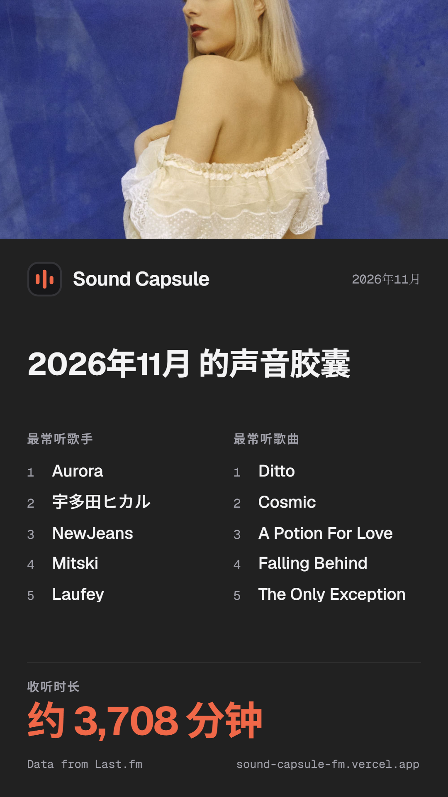

[English](../../README.md) · [Português](README.pt-BR.md) · [Español](README.es.md) · [Français](README.fr.md) · [Deutsch](README.de.md) · [Italiano](README.it.md) · [日本語](README.ja.md) · [한국어](README.ko.md) · **简体中文** · [Русский](README.ru.md) · [Polski](README.pl.md)

# Sound Capsule

把你的 Last.fm 收听记录变成一张可随时下载或分享的**竖版 1080×1920 声音胶囊**（快拍格式）。所有聚合都在浏览器中完成，无需登录，也没有数据库。

**部署：** <https://sound-capsule-fm.vercel.app>



> 示例卡片使用演示数据（Aurora 照片来自 Deezer），隐藏用户名，Ember 主题，3,708 分钟。


## 功能

- **首页**：包含用户输入（支持用户名或个人主页 URL）、时间范围（最近一周、本月或自定义范围）、9:16 预览以及下载/分享操作。
- **最长 3 个自然月的自定义范围** —— 没有固定的 90 天窗口，所选日期也不受限制（从 Last.fm 注册日期到今天）。
- **9:16 卡片**（CSS 尺寸 432×768，导出为 1080×1920 PNG），上方 30% 为歌手照片，主体为纯色 `#212121`。
- **五种固定配色主题**（Ember、Tide、Moss、Plum、Sand）只改变卡片的强调色 —— 没有自由取色器。
- **歌手照片**分三层：Deezer 自动匹配 → 可选的本地上传（绝不会发送到服务器）→ 带首字母的 canvas 兜底图。
- **两列带编号的内容**（最常听歌手和最常听歌曲，1–5），支持省略号截断和 CJK（日文、韩文和中文）。
- **预计收听时长**以主题纯色突出显示，附有解释计算方式的提示框，并通过 `Intl` 格式化。
- **自包含嵌入**：“复制嵌入代码”按钮会生成一个包含 base64 PNG 的 HTML `<a></a>` 区块 —— 无需上传、无需存储，也不依赖托管的图片 URL（约 0.5–0.8 MB）。可在允许原始 HTML 的地方使用。
- **链接预览**：将网站 URL 粘贴到 WhatsApp、Discord、Twitter/X、Telegram 等应用时，会显示本地化的标题和描述，以及带品牌的 1200×630 Open Graph 图片。
- **真实的分页进度**（“第 12 页，共 40 页”）、预览骨架屏，以及通过 `AbortController` 取消。
- **i18n**：支持 `pt`、`en`、`es`、`fr`、`de`、`it`、`ja`、`ko`、`zh`、`ru` 和 `pl`，具备 `Accept-Language` 检测、带前缀的路由、使用 `Intl` 格式化的文本/日期/数字，以及自定义的无障碍语言下拉菜单。
- **卡片署名**（“Data from Last.fm”、个人主页链接和站点 URL），并可选择在卡片上隐藏用户名。
- **`<canvas>` 背景**：带有会响应鼠标的细微波纹线条，标签页隐藏时暂停，并可通过 `prefers-reduced-motion` 关闭。
- **无障碍**：键盘导航、标签、`role="progressbar"`、警告、AA 对比度，并尊重“减少动态效果”设置。
- **可观测性**：使用无 Cookie 的 Vercel Web Analytics 和 Speed Insights 跟踪访问量和 Core Web Vitals。

## 持久化：仅语言和主题

| 数据 | 存储位置 | 详情 |
| --- | --- | --- |
| 语言 | `NEXT_LOCALE` Cookie | 仅 `pt`、`en` 等 |
| 卡片颜色 | `localStorage`（`sound-capsule:theme`） | 仅强调色 id |
| 用户名、日期、API 结果、上传的照片 | **内存** | 按 F5 后消失 |

切换语言会保留内存中的用户名和卡片（不会向 Last.fm 发起新请求），但重新加载页面会清除这些数据。不会持久化任何收听记录、历史或照片数据。

## 技术栈

| 层 | 选择 |
| --- | --- |
| 框架 | Next.js 15（App Router）+ TypeScript |
| 样式 | Tailwind CSS 4 |
| i18n | `next-intl` 4 |
| 图片导出 | `html-to-image`（客户端） |
| 测试 | Vitest |
| 部署 | Vercel（serverless，静态 + route handlers） |

## 工作原理

```text
浏览器
  ├─ 校验用户/时间范围（最多 3 个自然月）
  ├─ /api/lastfm  ──────────►  Last.fm API（密钥在服务端注入）
  │     └─ user.getInfo, user.getRecentTracks, track.getInfo
  ├─ 逐页获取全部收听记录页面（并发 3 + 150 ms 节流）
  ├─ 在内存中聚合：最常听歌手、最常听歌曲、收听时长
  ├─ /api/artist-image ─────►  Deezer 搜索（最佳归一化匹配）
  ├─ /api/image-proxy  ─────►  Deezer CDN（白名单 *.dzcdn.net）
  ├─ 可选的用户照片 ───────►  本地 canvas（绝不会离开浏览器）
  └─ 在 DOM 中渲染卡片并导出 1080×1920 PNG
```

应用不会在页面加载时获取数据，只在用户点击“生成胶囊”时获取。公开响应使用 `Vercel-CDN-Cache-Control` 进行 CDN 缓存；命中缓存时不会调用函数。

## 本地运行

### 环境要求

- Node.js **20.9+**
- pnpm **9+**（本仓库使用 pnpm 11 开发）

### 1. 获取 Last.fm API 密钥

1. 访问 <https://www.last.fm/api/account/create>。
2. 填写应用名称（例如 *Sound Capsule*）、URL `https://sound-capsule-fm.vercel.app` 和描述。
3. 复制生成的 **API 密钥**（不需要 *shared secret*，因为没有用户认证）。

### 2. 配置环境

```bash
cp .env.example .env.local
# 编辑 .env.local 并填写：
LASTFM_API_KEY=your_key_here
```

该变量**仅在服务端使用**。切勿使用 `NEXT_PUBLIC_` 前缀，它也不会进入客户端包。

### 3. 安装并运行

```bash
pnpm install
pnpm dev
```

打开 <http://localhost:3000> —— 中间件会重定向到根据 `Accept-Language`（或 `NEXT_LOCALE` Cookie）检测到的语言。

### 脚本

| 命令 | 说明 |
| --- | --- |
| `pnpm dev` | 开发服务器 |
| `pnpm build` | 生产构建 |
| `pnpm start` | 提供生产构建 |
| `pnpm test` | 单元测试（Vitest） |
| `pnpm test:watch` | 监听模式运行测试 |
| `pnpm typecheck` | 使用 `tsc --noEmit` 进行类型检查 |

## 部署到 Vercel

当前部署位于 <https://sound-capsule-fm.vercel.app>。

1. 将项目推送到 GitHub/GitLab/Bitbucket 仓库。
2. 在 Vercel 中点击 **Add New → Project** 并导入仓库。
3. 会自动检测 **Next.js** 预设。确认以下内容：
   - Install Command: `pnpm install`
   - Build Command: `pnpm build`
   - Output: Next.js 默认
4. 在 **Settings → Environment Variables** 中，为 Production 添加 `LASTFM_API_KEY`（如果想测试预览部署，也在 Preview/Development 中添加）。
5. 部署。无需配置数据库、迁移、cron 任务或存储。
6. 可选：在 **Settings → Domains** 中配置自定义域名。

该项目为 **Hobby** 套餐（个人/非商业）设计：每个典型胶囊约产生 60–176 次函数调用，CDN 缓存可避免重复调用稳定的接口。照片上传 100% 在本地完成，因此不消耗函数、带宽，也不受 Vercel 4.5 MB 请求体限制影响。

生产注意事项：

- 路由处理器使用 `AbortSignal.timeout(10s)` 访问上游；每次调用都很短且相互独立。
- `track.getInfo` 和图片在 CDN 中保留 24 小时；用户数据保留 1–5 分钟。错误从不缓存。
- 图片代理以流式模式响应，因此不会触及 4.5 MB 的非流式响应限制。
- CJK 字体在构建时由 `next/font` 自行托管；环境需要能访问 Google Fonts。

## 项目结构

```text
app/
  [locale]/
    layout.tsx            # 根布局：字体、i18n 提供者、元数据/SEO
    page.tsx              # 首页（服务端）+ CapsuleStudio（客户端）
    [...rest]/page.tsx    # 未知路由 → notFound()
  api/
    lastfm/route.ts       # 带方法和参数白名单的代理
    artist-image/route.ts # Deezer 搜索 + 归一化匹配
    image-proxy/route.ts  # 图片代理（白名单 + 流式）
  robots.ts               # robots.txt（阻止 /api/，指向站点地图）
  sitemap.ts              # 11 个路由的站点地图（含 alternates）
  globals.css             # 设计令牌（Tailwind 4）
  icon.svg                # 品牌/favicon
components/
  CapsuleStudio.tsx       # 表单、主题、上传、进度、导出/分享/嵌入
  CapsuleCard.tsx         # 带署名和主题的 432×768 卡片
  CardHero.tsx            # 歌手照片/上传或 canvas 兜底
  BackgroundCanvas.tsx    # 背景波纹（鼠标、减少动态效果、隐藏）
  SiteHeader.tsx / SiteFooter.tsx / BrandMark.tsx
  LocaleSwitcher.tsx      # 自定义的无障碍语言下拉菜单
i18n/                     # next-intl 路由/请求/导航
lib/
  lastfmClient.ts         # 分页、并发、节流、重试/退避、中止
  aggregate.ts            # 聚合与分钟估算（已测试）
  periods.ts              # 时间段、3 个月上限、Intl
  artistMatch.ts          # 归一化的 Deezer 匹配
  artistImage.ts          # 主图照片的解析/预加载
  localPhoto.ts           # 上传照片的本地校验/缩放
  cardThemes.ts           # 固定强调色与仅持久化 id
  studioSession.ts        # 用于切换语言的内存状态
  site.ts / httpCache.ts  # URL/User-Agent 与缓存头
  exportCard.ts           # 字体嵌入 + html-to-image → 1080×1920 PNG
  initials.ts / locales.ts
public/
  og/<locale>.png          # Open Graph/Twitter 预览 1200×630
  llms.txt                # 面向智能体/LLM 的项目摘要
messages/                 # pt, en, es, fr, de, it, ja, ko, zh, ru, pl
tests/                    # Vitest
../screenshots/         # 参考截图
```

## 链接预览、SEO 与可发现性

- 全部 11 个路由都设置了 `metadataBase` + Open Graph/Twitter Card，并带有本地化的标题和描述。
- `og:image` 和 `twitter:image` 使用 `public/og/<locale>.png` 图片（1200×630）；这是把链接粘贴到 WhatsApp、Discord、Telegram、Twitter/X 等应用时显示的预览图。
- `/robots.txt` 由 `app/robots.ts` 生成，允许站点、阻止 `/api/`，并指向站点地图。
- `/sitemap.xml` 由 `app/sitemap.ts` 生成，包含 11 个路由和 `hreflang` alternates。
- `/llms.txt` 为 AI 智能体提供关于产品、数据来源和隐私政策的事实性摘要。

## 技术决策

### 为什么用 `user.getRecentTracks` 而不用 `user.getTopTracks`？

`getTopTracks`/`getTopArtists` 只接受固定窗口（`7day`、`1month` 等），而 Last.fm 的“月”并不是当前自然月。应用通过 `from`/`to`（unix）分页获取 `user.getRecentTracks` 并在本地聚合，保证**“本月”**恰好是从 1 日到当前时刻（按访问者所在时区计算）。

- 每页 `limit=200`；第一页会获取 `totalPages`。
- 其余页面以**并发 3**并行执行，并在**调用之间加入 150 ms 节流**，以符合 Last.fm 的使用指引。
- 对错误 29（限流）、5xx 和网络故障使用**指数退避**重试。
- 忽略“正在播放”的歌曲（`@attr.nowplaying`）。
- **取消**按钮会中止所有进行中的请求（`AbortController`）。

### 收听时长

Last.fm 不提供收听时长。估算方式如下：

1. 获取**播放次数最多的 50 首歌曲**的真实时长（`track.getInfo` → `duration`，单位毫秒，并发 3）。
2. 没有时长、时长为 0 或不在前 50 名的歌曲按 **3.5 分钟（210 秒）**计算。
3. `minutes = round(Σ duration × scrobbles / 60,000)`。

界面将数值显示为近似值（`约 66 分钟`），提示框会解释计算方式。兜底值和前 50 名上限可在 `lib/periods.ts` 中配置。

### 歌手照片

Last.fm 不再返回真实照片（占位图）。应用会调用 Deezer，选择归一化相似度最高的结果，并在重名时优先**最热门的精确匹配** —— 否则可能出现不知名的“Twice”，而不是 TWICE。用户也可以上传本地照片（JPEG/PNG/WebP，最大 10 MB）：照片会在 canvas 上缩放，并仅用于浏览器内存。如果什么也没找到，卡片会使用程序化 canvas 兜底图。

### 主题

`lib/cardThemes.ts` 中的五种固定强调色；只会改变卡片的强调色（品牌和收听时长）。保存的主题数据只有所选 id，存放在 `localStorage`。站点本身保持中性。

### 跨语言状态

`CapsuleStudio` 将未本地化的数据保存在内存存储（`lib/studioSession.ts`）中。切换语言时，组件会重新挂载，从存储中水合，只用新语言重新计算文本 —— **对 Last.fm 的请求为零**。语言本身保存在 `NEXT_LOCALE` Cookie 中。

### 导出 1080×1920

`html-to-image` 以 `pixelRatio: 2.5` 渲染卡片（432×768）。导出前：

- `document.fonts.ready` + 两帧布局；
- 解码卡片中的每个 ``；
- 定制的字体嵌入只包含 **`unicode-range` 与卡片字符相交的子集**，避免下载数 MB 不必要的 CJK 分片。

最终 PNG 精确为 **1080×1920**（已在浏览器中验证，包括用户上传的照片）。

### 设计

中性配色，每张卡片只有一种纯色强调色，不使用霓虹/渐变/玻璃拟态：

| 令牌 | 值 |
| --- | --- |
| 背景 | `#0f0f10` |
| 表单表面 | `#171719` |
| 输入框 | `#111113` |
| 卡片主体 | `#212121` |
| 强调色 | Ember `#F06848`、Tide `#5B9DFF`、Moss `#7ED08A`、Plum `#C084FC`、Sand `#E7C27A` |
| 文本 | `#f4f4f5` / 弱化 `#a1a1aa` |

排版：Geist（无衬线）+ Geist Mono（数字/细节）+ 用于 CJK 的 Noto Sans JP/KR/SC。

## 隐私、安全与条款

- `LASTFM_API_KEY` 只存在于服务端；客户端永远不会收到它。
- `/api/lastfm` 只接受 `user.getInfo`、`user.getRecentTracks` 和 `track.getInfo`；它会拒绝客户端发送的 `api_key`/`format`，并校验整数（范围和上限）、用户名和控制字符。
- `/api/image-proxy` 只接受 `*.dzcdn.net` 上的 `https` URL，在重定向后重新校验主机，要求 `Content-Type: image/*`，并以流式模式响应。
- 应用会向 Last.fm/Deezer 发送可识别的 User-Agent。
- 按照 [Last.fm TOS](https://www.last.fm/api/tos) 进行署名：页脚的“powered by Last.fm”链接，以及导出卡片上的“Data from Last.fm”、个人主页和站点 URL 署名。
- **仅持久化**：语言（Cookie）和卡片强调色（`localStorage`）。没有数据库、收听记录存储、登录或会话 Cookie。
- 用户历史中没有任何内容被写入应用日志。本项目为个人非商业项目。

### 可观测性

- Vercel Web Analytics（`@vercel/analytics`）和 Speed Insights（`@vercel/speed-insights`）已安装在语言布局中。
- 两者均不使用 Cookie：不收集用户名、卡片数据或收听记录数据。
- 在 Hobby 套餐中，Web Analytics 每月包含 50,000 个事件，Speed Insights 包含最近 30 天内的 10,000 个事件；在上限内均免费，超出后收集会暂停而不会计费。

## i18n

- 语言：`pt`（默认，pt-BR 内容）、`en`、`es`、`fr`、`de`、`it`、`ja`、`ko`、`zh`（简体中文）、`ru` 和 `pl`。
- 中间件通过 `Accept-Language` 检测（`NEXT_LOCALE` Cookie 优先）；在页眉中手动切换会保留路由和内存中的卡片。选择器是自定义下拉菜单，而不是原生 `<select>`。
- 日期和数字使用 `Intl`，并采用正确的区域设置（`pt-BR`、`en-US`、`es-ES`、`fr-FR`、`de-DE`、`it-IT`、`ja-JP`、`ko-KR`、`zh-CN`、`ru-RU`、`pl-PL`）。
- 卡片文本随界面一起翻译；导出的图片已经使用当前语言。
- 字体：Geist 加载拉丁/拉丁扩展/西里尔字母；Noto Sans JP/KR/SC 覆盖卡片中的 CJK 字符。

## 测试

```bash
pnpm test        # 108 个单元测试
pnpm typecheck
pnpm build
```

当前覆盖范围：

- 粘贴到用户字段中的个人主页 URL 的归一化；
- 收听记录聚合、平局规则、CJK 和收听时长计算；
- 时间段间隔、**3 个自然月**上限、2 月/31 天的月份、注册日期、未来日期和 `Intl`；
- 使用模拟 `fetch` 的 Last.fm 客户端：分页、正在播放、重试 29/网络、中止、前 50 时长、错误 6/17、注册日期（`unixtime`）；
- Deezer 歌手匹配（包括重名时按热度打破平局）；
- API 路由：白名单、服务端密钥、User-Agent、缓存头、图片代理流式传输；
- 主题和会话存储；
- 本地上传校验（类型/大小）。

此外，还在 Chromium 中用模拟的 Last.fm/Deezer 验证了完整流程：主题、上传、署名、隐藏用户名、自包含嵌入（剪贴板）、切换语言不产生新请求、自定义下拉菜单（鼠标、键盘和点击外部）、`ko`/`ru`/`zh`/`pl` 路由、移动端自动滚动到预览、仅允许 Cookie/localStorage、F5、3 个自然月校验，以及 **1080×1920** 导出。真实流程也使用活跃个人主页对 Last.fm/Deezer API 运行过。

## 已知限制

- **最长 3 个自然月的时间段**：为符合 Last.fm 的合理使用和 Hobby 套餐而设计。年度回顾需要不同的架构/限制。
- **收听时长是估算值**：取决于 `track.getInfo` 的时长和 210 秒兜底值；现场版/混音版可能有偏差。
- **照片来自 Deezer**：同名歌手的名称匹配可能失败或找不到任何结果（此时使用 canvas 兜底图）。使用其他文字系统的名字（例如 南翔子，被索引为“Shoko Minami”）可能无法匹配。本地上传可以覆盖这些情况。
- **上传不会被持久化**：照片只存在于内存中，按 F5 后与结果和用户名一样消失。
- **私密个人主页**（“hide recent listening”）会返回错误 17；应用会说明如何开启。
- **客户端导出**取决于浏览器（已在 Chromium 中测试）。在内存较小的旧设备/Safari 上，PNG 可能生成失败；此时会显示错误消息。
- **Web Share API** 并非在所有浏览器中可用；在这些情况下，应用会下载 PNG。
- 卡片只会在照片和字体加载完成后渲染；预览会等待加载完成后再启用 PNG。

## 故障排查

| 症状 | 可能原因 / 解决方案 |
| --- | --- |
| “服务器缺少 Last.fm API 密钥” | `.env.local`（或 Vercel）中缺少 `LASTFM_API_KEY`；重启服务器。 |
| “在 Last.fm 上找不到该用户” | 用户名无效或不存在；请在 `last.fm/user/<name>` 检查。 |
| “该用户的收听记录已设为私密” | 在 Last.fm 的隐私设置中开启“Show recent listening”。 |
| “该时间段内没有收听记录” | 所选时间段没有公开历史。 |
| “Last.fm 请求过于频繁” | 稍等片刻后重试；应用本身已经采用了节流和退避。 |
| 预览没有照片 | Deezer 没有找到该歌手；上传照片或使用几何兜底图。 |
| “请使用 JPEG、PNG 或 WebP 格式” / “图片大小不能超过 10 MB” | 本地照片的格式/大小超出允许范围。 |
| CJK 字体不显示 | 检查构建时能否从 Google Fonts 下载 Noto Sans JP/KR/SC。 |
| 构建在 `prerender /404` 处失败 | `node_modules` 损坏的表现；删除 `node_modules` 并重新运行 `pnpm install`。 |

## 免责声明

Sound Capsule 是一个独立项目，与 Last.fm 或任何流媒体服务无关。音乐数据是公开的，由 Last.fm API 提供；歌手照片来自 Deezer 或用户。Vercel Hobby 套餐的使用为个人非商业用途。

## 致谢

作者：[Ranieeery](https://github.com/Ranieeery)。


